# 🎮 3DO ODE — Menú, Firmware y Medios

[English](README.md) · [Português](README.pt.md) · **Español**

Menú (`boot.iso`), firmware y generador de tarjeta para la **ODE SataTo3DO** (placa RP2040) de la 3DO, por **Rodrigo Tadeu "CyberRep"**. El menú está en **3 idiomas** (español, inglés, portugués), funciona en **NTSC y PAL** y con los **dos firmwares**: el de fábrica y el nuestro, **TADEU**.

> 💿🔥 **NUEVO Y EXCLUSIVO — ¡JUEGA TUS CDs ORIGINALES CON EL XPORT CONECTADO, DIRECTO DESDE EL MENÚ!** Quien usa la placa de expansión (Xport) siempre tuvo que **apagar la consola y quitar la placa** para jugar un disco de verdad: el menú de fábrica del Xport no lo hace. Ahora el menú muestra una caja **CD** en la pantalla principal: pulsa **A**, abre y cierra la tapa, y la 3DO **se reinicia sola en tu disco**. Sin desmontar nada. [Cómo funciona](#-cd-de-verdad-en-el-xport-sin-quitar-la-placa).

> ⏰ **La primera ODE de 3DO del mundo con reloj de tiempo real (RTC).** Con un módulo DS3231 muy barato soldado en 4 puntos, tu 3DO muestra la fecha, la hora y la temperatura, y guarda cuándo se jugó cada juego. [Mira cómo instalarlo](docs/RTC.es.md).

> 🌐 **Empieza por aquí — prepara tu USB / SD desde el navegador, sin instalar nada:** **[https://cyberrep.github.io/3doode/](https://cyberrep.github.io/3doode/)** (Chrome o Edge en el ordenador). 📖 [Manual de la página](docs/SITE.es.md)

> **¿Prefieres hacerlo en el PC, o necesitas convertir juegos?** Ejecuta **`generate_usb.py`** — un **único archivo** que hace todo lo demás: descarga el arte, convierte carátulas, capturas y vídeos, arma los textos de los juegos y **copia el `boot.iso` (el menú)** al USB.

**Versiones actuales:** menú **1.5** · firmware **TADEU 1.0.6** · [historial completo](CHANGELOG.es.md)

> ⚠️ **¿Vienes de la 1.3?** En la 1.4 las portadas y las capturas cambiaron: las portadas ahora se graban **en su proporción real** (las long box y las cajas de CD ya no se estiran) y las imágenes quedaron **más nítidas y limpias**. Las imágenes antiguas **siguen funcionando** en el menú 1.4, pero se ven como antes (estiradas y con grano). Para ver la diferencia, **graba los medios de nuevo**: la [página web](https://cyberrep.github.io/3doode/) cambia sola las portadas y capturas antiguas de la tarjeta en la primera grabación; en el `generate_usb.py` se rehacen en la primera ejecución. Actualiza el `boot.iso` a la vez.

> 🟣 **TADEU** — este sello marca, en todo el texto, lo que **solo existe con el firmware TADEU**. Todo lo que no lleva el sello funciona también con el firmware de fábrica. El menú descubre por sí solo lo que tiene tu ODE y **solo muestra lo que funciona**: nada aparece a medias ni falla por falta de una función.

---

## ✨ Lo más destacado

| | |
|---|---|
| 💿🔥 **CD de verdad en el Xport** | **Exclusivo de este menú.** Con la placa de expansión conectada, aparece una caja **CD** en la pantalla principal que lleva la consola al disco del lector, sin quitar la placa. [Ver](#-cd-de-verdad-en-el-xport-sin-quitar-la-placa). |
| ⏰ **Reloj de tiempo real** 🟣 **TADEU** | Fecha, hora y temperatura en pantalla y el "jugado el" de cada juego. El reloj se **detecta solo**: sin el módulo, nada aparece y nada cambia. [Instalación del DS3231](docs/RTC.es.md). |
| 🎨 **Totalmente personalizable** | Tú armas tu menú: 6 modos de vista, 9 fondos, qué aparece en cada pantalla, el orden de la lista, la pantalla en la que arranca la consola. [Ver todo](#-a-tu-manera). |
| 🕹️ **Reconoce tu consola** | Lee la BIOS y muestra la foto de tu aparato: Panasonic FZ-1, FZ-10, GoldStar o Sanyo TRY, con región y NTSC/PAL. |
| 🔌 **Funciona con los dos firmwares** | No hace falta cambiar el firmware para usar el menú. Con TADEU es más rápido y gana las funciones con el sello 🟣. |
| 💿 **Un `boot.iso` para todo** | El mismo archivo sirve a la ODE interna y a la placa de expansión (Xport), en NTSC y PAL. |

### 🟣 Lo que solo hace el firmware TADEU

| | |
|---|---|
| ⚡ **Lista de juegos rápida** | Los juegos se reconocen sin abrir cada archivo. Un juego del final del USB arranca en 2 a 4 s, en vez de unos 30 s. |
| 📊 **Espacio del USB o la SD** | Tamaño y espacio libre del medio, en barra, en el menú principal. |
| 📁 **Creación de carpetas** | La consola crea sola las carpetas que necesita (`.config`, `saves`, `roms`, `firmware`). |
| ⏰ **Reloj de tiempo real** | Fecha, hora y temperatura, con el módulo DS3231. Detectado solo. |
| 🗓️ **Archivos con fecha y hora** | Todo lo que la consola graba en el USB sale con la fecha correcta. |
| 💾 **Copia de seguridad del firmware** | Copia el firmware de la ODE al USB, desde el menú. |
| 🔄 **Actualización desde el menú** | Graba el firmware nuevo sin abrir la consola y sin PC, verificándolo antes de aplicarlo. |
| 🛟 **Siempre recuperable** | Si algo sale mal, el BOOTSEL y un `.uf2` lo resuelven. |

El menú muestra lo que tiene tu ODE en *Opciones → Dispositivo ODE → Recursos*:

<table>
<tr>
<td align="center"><b>Con el firmware TADEU</b><br>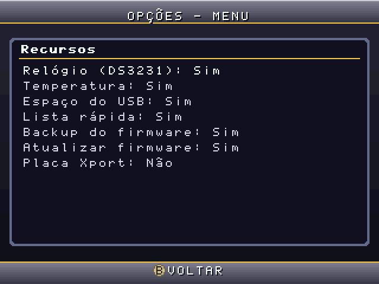</td>
<td align="center"><b>Con el firmware de fábrica</b><br>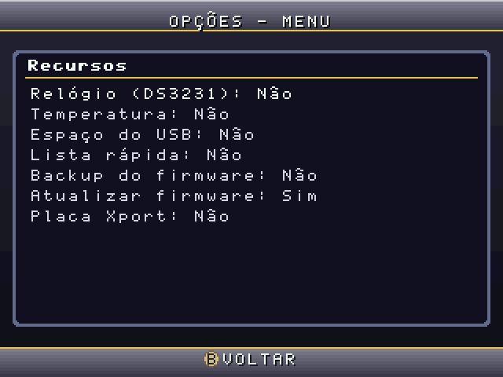</td>
</tr>
</table>

## 📋 Todo lo que hace

| | |
|---|---|
| 🖼️ **6 modos de vista** | Lista, Portadas, Carrusel, Carrusel FX, Vitrina y Tira. |
| 🎬 **Vista previa en vídeo** | Vídeo en **Cinepak**, en la lista, en la descripción y a pantalla completa. |
| ⭐ **Favoritos, Recientes y Estadísticas** | Ranking de los más jugados y contador de partidas. Con el reloj, también la fecha y la hora de cada partida. |
| 🔎 **Filtro y orden** | Filtra por género y país; ordena por nombre, año, género, desarrollador o más jugados. |
| 💿 **Multidisco automático** | Inicia el disco 1 y los demás entran solos en la cola. |
| 📊 **Espacio del USB o la SD** 🟣 **TADEU** | Barra con el tamaño y el espacio libre del medio en el menú principal, junto a la barra de la NVRAM. |
| 🔀 **USB o SD, solo** | En la placa de expansión (Xport), el menú descubre si el medio es un pendrive o una tarjeta microSD y cambia todos los textos: "USB" pasa a ser "SD". |
| 💾 **Partidas guardadas** | Gestor de partidas consola ↔ USB, copia y restauración de toda la NVRAM. |
| 🧰 **Herramientas de la consola** | Prueba de hasta 8 mandos, ajuste de imagen, extracción de ROM y RAM, información completa. |
| 🔄 **Firmware desde la consola** 🟣 **TADEU** | Copia de seguridad y actualización del firmware de la ODE sin abrir el aparato y sin PC. |
| 🎵 **Sonido** | Efectos de sonido, 10 músicas de fondo y volumen en barra. |
| 🌐 **3 idiomas** | Español, Português e English, cambiados al instante. |
| 🛠️ **Un solo archivo para preparar el USB** | `generate_usb.py` descarga el arte, lo convierte todo y copia el menú. |

---

## 📸 Pantallas

<table>
<tr>
<td align="center"><b>Menú principal</b><br>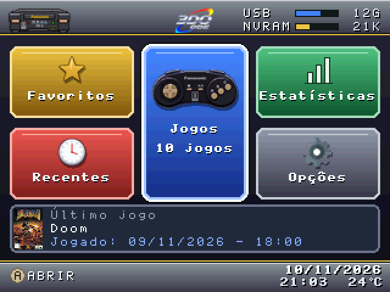</td>
<td align="center"><b>Descripción del juego</b><br>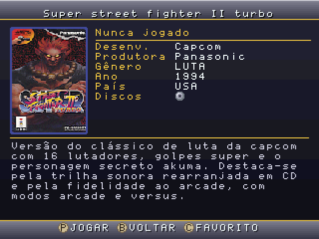</td>
</tr>
<tr>
<td align="center"><b>Lista</b><br>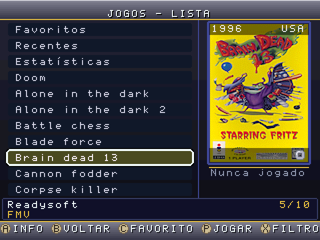</td>
<td align="center"><b>Portadas</b><br>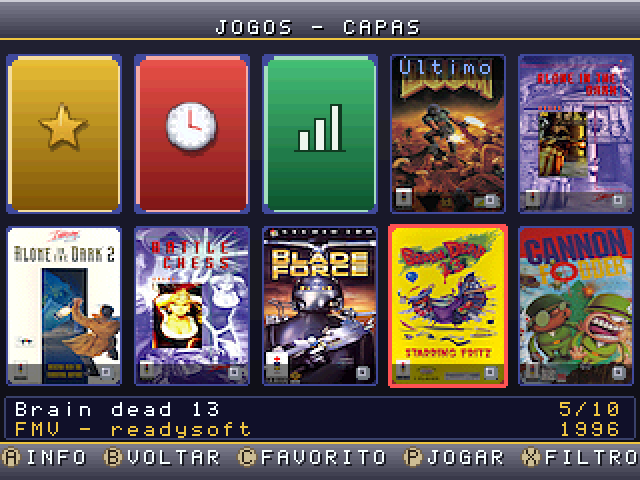</td>
</tr>
<tr>
<td align="center"><b>Carrusel</b><br>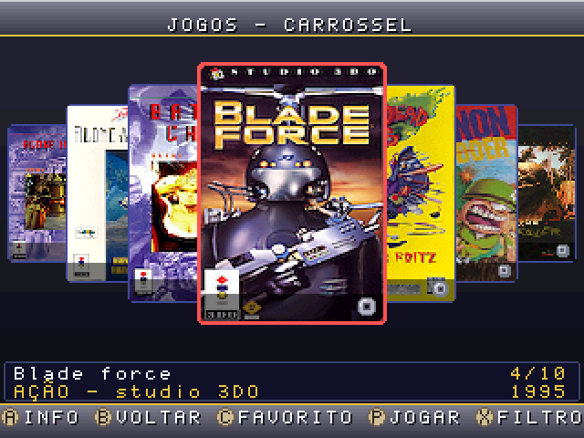</td>
<td align="center"><b>Carrusel FX</b><br>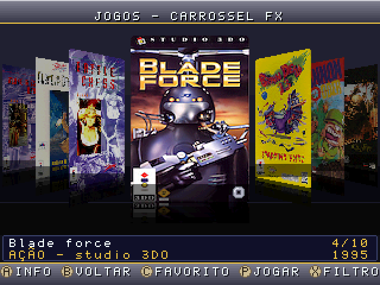</td>
</tr>
<tr>
<td align="center"><b>Vitrina</b><br>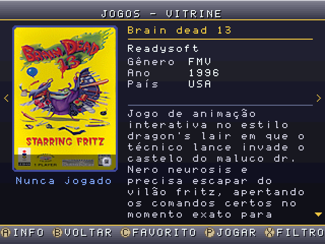</td>
<td align="center"><b>Tira</b><br>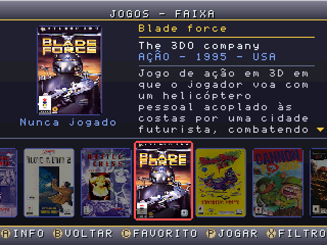</td>
</tr>
<tr>
<td align="center"><b>Opciones</b><br>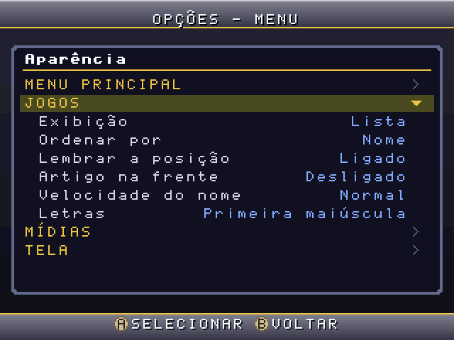</td>
<td align="center"><b>Filtro</b><br>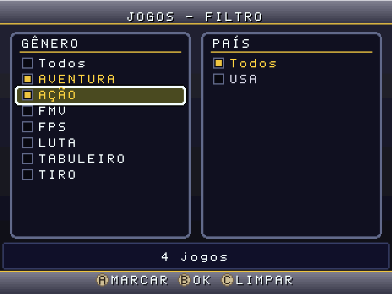</td>
</tr>
<tr>
<td align="center"><b>Estadísticas</b><br>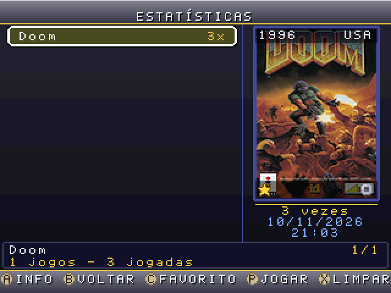</td>
<td align="center"><b>Información de la consola</b><br>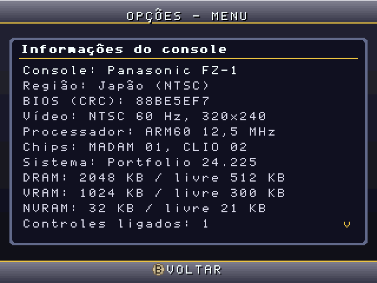</td>
</tr>
</table>

Las pantallas de arriba están en portugués; el menú las muestra en el idioma que elijas.

---

## 🎨 A tu manera

El menú es **totalmente personalizable**. Cada persona deja la 3DO con el aspecto que quiera, y todo se guarda solo en el USB.

| Lo que eliges | Opciones |
|---|---|
| **Cómo ver los juegos** | 6 modos: Lista, Portadas, Carrusel, Carrusel FX, Vitrina, Tira. |
| **El fondo de las pantallas** | 9 fondos: Predeterminado, Fibra de carbono, Acero cepillado, Panal, Rayas, Rejilla, Chapa, Viñeta, Puntos. |
| **Qué aparece en el menú principal** | Favoritos, Recientes, Estadísticas y Último juego: en el menú, dentro de Juegos, en los dos o en ninguno. |
| **La información en pantalla** | Hora, fecha, temperatura, espacio del USB y espacio de la NVRAM: cada una se puede mostrar u ocultar. |
| **Dónde arranca la consola** | Menú principal, Juegos, Favoritos o Recientes. |
| **El orden de la lista** | Nombre, año, género, desarrollador o más jugados; con o sin el artículo delante; recordando o no la última posición. |
| **Qué aparece junto a la lista** | Nada, la portada, la captura o el vídeo del juego. |
| **Qué muestra la descripción** | 10 combinaciones de portada, captura y vídeo. |
| **Los textos** | MAYÚSCULAS, minúsculas o Primera mayúscula; 5 velocidades para los nombres largos; 3 idiomas. |
| **El sonido** | Efectos activados o no, 10 músicas o una al azar, volumen en barra. |
| **El descanso** | Protector de pantalla a los 1, 3, 5 o 10 minutos, o desactivado. |
| **El reloj** | 12 o 24 horas. |

Y para no perder nada: **copia y restauración** de la configuración, los favoritos, los recientes y las estadísticas, y un botón para **volver a los valores predeterminados**.

---

## ⏰ Reloj de tiempo real (RTC)

🟣 **TADEU** 1.0.5 o más nuevo, con el módulo DS3231.

La 3DO nunca tuvo reloj. Con el firmware **TADEU 1.0.5** y un módulo **DS3231** conectado al Pico de la ODE, pasa a tener:

- **Fecha, hora y temperatura** en el menú principal (cada una se puede ocultar en Opciones).
- **"Jugado: dd/mm/aaaa - hh:mm"** en el panel del último juego, en Recientes y en Estadísticas.
- **Archivos con la fecha correcta** en el USB: las copias de la NVRAM llevan la fecha y la hora en el nombre.
- **Ajuste desde la propia consola**, en *Opciones → Dispositivo ODE → Fecha y hora*, en 12 o 24 horas.
- **Aviso de pila baja**: si el reloj perdió la hora, el menú avisa al encender y ofrece ajustarla.
- **Formato por idioma**: día/mes/año y °C en español y portugués; mes/día/año y °F en inglés.

Son **4 cables** en el Pico. El paso a paso, con el dibujo de los pines, está en **[docs/RTC.es.md](docs/RTC.es.md)**.

<p align="center"></p>

### Detección automática del reloj

Al encender, el menú pregunta a la ODE si existe un reloj y si tiene la hora correcta.

- **Con el módulo instalado**: aparecen la fecha, la hora y la temperatura, y las opciones del reloj entran en el menú.
- **Sin el módulo** (o con el firmware de fábrica): **nada aparece y nada cambia**. No hay reloj a cero, mensaje de error ni opción muerta: el menú queda exactamente como siempre.
- **Con el módulo y la pila baja**: el menú avisa una vez, al encender, y ofrece ajustar la hora.

Para comprobarlo: *Opciones → Dispositivo ODE → Recursos* muestra **Reloj (DS3231): Sí** o **No**.

---

## 🕹️ Detección automática de la consola

Al encender, el menú lee un tramo de 256 bytes de la BIOS, calcula su firma y descubre en qué aparato está funcionando. Es instantáneo (leer la BIOS entera llevaría unos 8 segundos).

| Consola | Regiones reconocidas |
|---|---|
| **Panasonic FZ-1** | EE. UU., Japón, Europa (PAL), unidades de desarrollo |
| **Panasonic FZ-10** | EE. UU., Japón, Europa (PAL) |
| **GoldStar** | EE. UU. |
| **Sanyo TRY** | Japón |

Con eso el menú:

- muestra la **foto de tu consola** arriba en el menú principal y en la pantalla de éxito de la actualización del firmware;
- informa de consola, región, firma de la BIOS, sistema de vídeo, chips, memoria libre, mandos conectados y módulo FMV en *Opciones → Consola 3DO → Información de la consola*;
- solo ofrece la extracción de la **ROM del FMV** si el módulo existe.

**NTSC o PAL** se pregunta al sistema, y la pantalla se ajusta sola. Una revisión de BIOS que aún no está en la tabla aparece como "Desconocido" y el menú funciona con normalidad, solo que sin la foto.

---

## 🔌 Los dos firmwares

La ODE SataTo3DO tiene un firmware en la placa RP2040. Existen dos:

- **De fábrica** — el que ya viene en la placa.
- **TADEU (el nuestro)** — opcional. Lo hace todo **mucho más rápido** y activa las funciones nuevas.

El **menú funciona con los dos**: al encender, pregunta a la ODE qué firmware y qué versión hay, y solo muestra lo que ese firmware sabe hacer. Nada se cuelga por falta de una función.

| Función | De fábrica | TADEU |
|---|:---:|:---:|
| Menú completo, 6 vistas, vídeo, favoritos, estadísticas, partidas | ✅ | ✅ |
| Lista de juegos rápida (un juego del final del USB arranca en 2–4 s en vez de ~30 s) | — | ✅ |
| Crear carpetas en el USB desde la consola | — | ✅ |
| Espacio libre del USB en el menú | — | ✅ (1.0.4+) |
| Copia de seguridad del firmware desde la consola | — | ✅ |
| Actualización del firmware desde el menú | — | ✅ |
| Reloj, fecha, hora y temperatura (con el DS3231) | — | ✅ (1.0.5) |
| Archivos grabados con fecha y hora | — | ✅ (1.0.5) |

Comprueba lo que tiene tu ODE en *Opciones → Dispositivo ODE → Recursos*. Todo lo que depende de TADEU lleva el sello 🟣 en este documento.

<table>
<tr>
<td align="center"><b>Información del ODE — TADEU</b><br>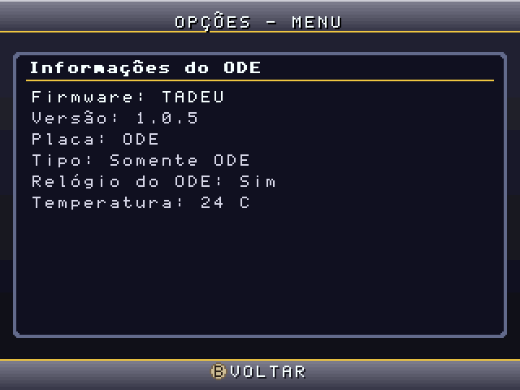</td>
<td align="center"><b>Información del ODE — de fábrica</b><br>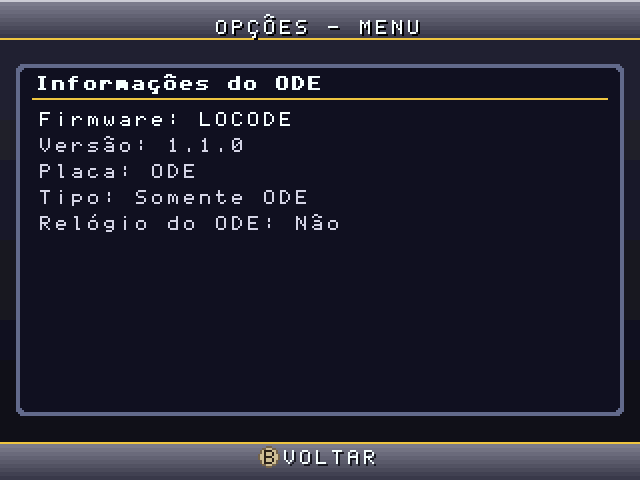</td>
</tr>
</table>

### 🟣 Lo que TADEU cambia por dentro

- **Lista por extensión**: los juegos se reconocen por `.cue` y `.iso` sin abrir cada archivo. La comprobación de verdad queda para el momento de jugar.
- **Paginación incremental**: avanzar en la lista continúa desde donde se quedó, en vez de reiniciar la carpeta en cada página.
- **Creación de carpetas** (`.config/`, `saves/`, `roms/`, `firmware/`).
- **Copia de seguridad del firmware**: copia la flash del Pico al USB, verificada byte a byte.
- **Actualización a prueba de fallos**: el firmware nuevo va a una zona de espera, se verifica por CRC y solo entonces se aplica. Si algo sale mal, el firmware actual sigue ahí.
- **Siempre recuperable**: mantén BOOTSEL, conecta el Pico al PC y arrastra un `.uf2`.
- **Número de serie del chip**: el firmware sabe informar el identificador único del Pico.
- **Espacio del USB** (tamaño y libre).
- **Reloj DS3231**: fecha, hora, temperatura y estado de la pila.
- **Un código fuente para las dos placas**: la original (RP2040-Plus, 4 MB) y la clon con un Pico común (2 MB).

### Solo ODE u ODE + CD-ROM

El menú detecta solo cuántas unidades existen y lo muestra en *Información del ODE* como **"Solo ODE"** u **"ODE + CD-ROM"**. Al instalar el firmware, usa el `.uf2` de **tu placa**: grabar el de la otra deja la pantalla en negro después del logo (basta con volver a grabar el correcto por BOOTSEL). Desde la 1.0.6 los archivos se llaman **DIR-LOW** (placa original Waveshare, chip 74HC245) y **DIR-HIGH** (placas clon como tzmwx y TaiHu, chip 74LVC4245).

### Placa de expansión (Xport)

El **mismo `boot.iso`** funciona en la ODE del puerto de expansión. El menú reconoce la placa y aplica el ajuste de memoria que necesita.

**USB o SD, solo:** la placa acepta pendrive y tarjeta microSD. El menú descubre cuál de los dos está en uso y cambia los textos de todo el sistema: "Leyendo el USB" pasa a ser "Leyendo la SD", "Información del USB" pasa a ser "Información de la SD", y así sucesivamente.

### 💿 CD de verdad en el Xport, sin quitar la placa

> **El gran destacado de esta versión.** El Xport va en el puerto de expansión y el lector de CD de la consola sigue ahí, pero la consola siempre arranca por el Xport. Hasta ahora, para jugar un disco original había que apagar todo y quitar la placa: el menú de fábrica del Xport no tiene esa función. **Este menú sí.**

<p align="center">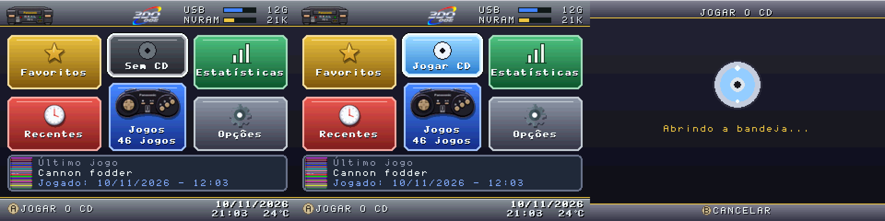</p>

Cómo funciona:

1. Con el Xport conectado, la pantalla principal gana la caja **CD**, encima de **Juegos**. Es **gris oscura** cuando no hay disco en el lector y **azul clara** cuando lo hay. (En la ODE interna la caja no aparece: allí no hay lector de CD.)
2. Elige la caja y pulsa **A**. El menú guarda tus listas, para la música y saca el Xport del puerto.
3. **Panasonic FZ-10 (tapa):** la pantalla pide **"Abre la tapa del CD"** y luego **"Cierra la tapa del CD"**. Puedes aprovechar para cambiar el disco.
   **Consolas con bandeja (FZ-1, GoldStar, Sanyo):** el menú ordena al lector abrir y cerrar la bandeja solo; si el lector no obedece, la pantalla pide pulsar el botón de la bandeja.
4. La pantalla muestra **"Cargando el CD..."** y la consola **se reinicia sola en el juego del disco**.

**B** cancela en cualquier paso. Si el disco no arranca, el Xport vuelve al puerto y el menú sigue con normalidad. Para volver al menú después de jugar el CD, apaga y enciende la consola.

> **Estado de las pruebas:** el cambio fue confirmado en consola real en la **Panasonic FZ-10** (abrir y cerrar la tapa lleva la consola al disco). La apertura automática de la **bandeja** en los otros modelos y esta primera versión dentro del menú siguen en pruebas: si algo no funciona en tu consola, [avisa](../../issues).

### Descripción del juego: tú eliges lo que aparece

El **nombre del juego va en la barra de arriba** (si es más largo que la barra, se desplaza despacio). Debajo va la **ficha del juego**: "Jugado: 2x - Última 10/11/2026", **desarrolladora**, **productora**, género, año, país y discos (un icono por disco). En *Opciones > Apariencia > Descripción* cada dato se puede **mostrar u ocultar**. El texto más largo que el espacio **se desplaza solo**, y desplazar la descripción no detiene el vídeo.

La disposición sigue las imágenes elegidas en *Medios > Descripción*: con **una imagen**, queda a la izquierda y la ficha a la derecha; con **dos**, ambas van a la izquierda y la ficha y el texto a la derecha; con **tres** (carátula, captura y vídeo), las imágenes van arriba.

<p align="center">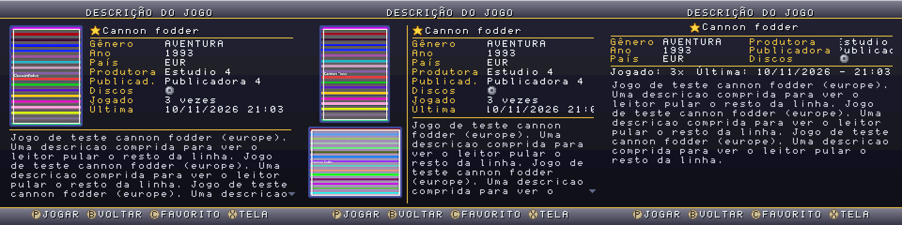</p>

---

## 📺 El menú

### Menú principal

Cinco cajas: **Favoritos**, **Juegos**, **Estadísticas**, **Recientes** y **Opciones**, y debajo el panel del **Último juego**, con la portada, el nombre y cuándo se jugó.

- Arriba: la foto de la consola y la barra de espacio de la **NVRAM** (las partidas de la consola).
- 🟣 **TADEU** Al lado, la barra de **espacio del USB o la SD**, con el tamaño y el espacio libre.
- 🟣 **TADEU** Abajo: **fecha, hora y temperatura** (con el reloj instalado).
- En el panel del último juego: **A** abre la descripción, **P** juega directamente.
- Favoritos, Recientes, Estadísticas y Último juego pueden aparecer en el menú, dentro de Juegos, en los dos o en ninguno.
- Se puede elegir en qué pantalla arranca la consola: Menú principal, Juegos, Favoritos o Recientes.

### 🖼️ Los 6 modos de vista

Elige en *Opciones → Apariencia → Juegos → Vista*.

| Modo | Cómo es |
|---|---|
| **Lista** | Nombres a la izquierda; a la derecha la portada, la captura o el **vídeo** del juego, con año, país, discos y favorito. |
| **Portadas** | Cuadrícula de portadas, la seleccionada con borde rojo. |
| **Carrusel** | Portada grande en el centro y las vecinas más pequeñas a los lados. |
| **Carrusel FX** | El carrusel en perspectiva, con reflejo en el suelo y animación. |
| **Vitrina** | Portada grande a la izquierda y, al lado, editor, desarrollador, género, año, país y la **descripción** entera. |
| **Tira** | La **captura del juego** y la descripción arriba; abajo, una fila de portadas que se desliza. |

En todos: una franja translúcida en la portada con un icono por disco y la estrella de favorito, y un CD en lugar de la portada que falte.

### Botones

| Dónde | Botones |
|---|---|
| **Menú principal** | La cruceta elige · **A** abre · **P** juega el último juego |
| **Juegos** | **A** descripción · **B** vuelve · **C** favorito · **P** juega · **X** filtro · **L / R** salta a la letra anterior / siguiente |
| **Vitrina y Tira** | ◄ ► cambia de juego · ▲ ▼ desplaza la descripción |
| **Descripción** | **P** juega · **B** vuelve · **C** favorito · **X** vídeo o captura a pantalla completa · ◄ ► juego anterior / siguiente · ▲ ▼ desplaza el texto |
| **Favoritos** | **A** descripción · **B** vuelve · **C** quita de favoritos · **P** juega |
| **Recientes y Estadísticas** | Igual que Juegos, con **X** para limpiar la lista |
| **Filtro** | **A** marca · **C** limpia · **B** aplica y vuelve |
| **Opciones** | ▲ ▼ mueve · ◄ ► o **A** cambia · **B** vuelve |

Mantener la cruceta acelera el desplazamiento.

### La lista de juegos

- **Una sola lista o por carpetas**: por defecto, los juegos en subcarpetas (hasta 3 niveles) entran en una sola lista en orden alfabético. La nueva opción **Mostrar juegos: Carpetas** permite navegar por las carpetas de la tarjeta (entra con **A**, vuelve con **B**); una carpeta con un solo juego se vuelve ese juego.
- **Orden**: por nombre, año, género, desarrollador o más jugados. **L / R** salta de grupo en grupo (letra, año, género…).
- **Artículo delante**: muestra "The Need for Speed" en vez de "Need for Speed, The".
- **Multidisco**: los discos de un juego son una sola entrada. Al jugar, todos entran en la cola de la ODE.
- **Recordar la posición**: al abrir Juegos, la selección vuelve al último juego jugado.
- **Lista guardada**: el menú puede guardar la lista de juegos y arrancar mucho más rápido (*Leer al encender*: Sí, Solo si hay nuevos, No).
- **Los nombres largos** se desplazan solos, en 5 velocidades.
- **Formatos de juego**: `.iso` y `.cue` + `.bin`. El generador convierte `.chd` en el PC.

### Descripción del juego

Portada, captura y vídeo del juego (eliges la combinación entre 10), género, año, país, desarrollador y la descripción completa. **X** abre el vídeo o la captura a pantalla completa.

### Juego iniciando

Al pulsar **P** aparece la tarjeta del juego: portada, nombre, género, año y país, cuántas veces se jugó y, en juegos de varios discos, "N discos añadidos a la cola".

### ⭐ Favoritos, 🕑 Recientes y 📊 Estadísticas

- **Favoritos**: **C** marca y desmarca, con la animación y el sonido de la estrella.
- **Recientes**: los últimos juegos. 🟣 **TADEU** Con el reloj, también la fecha y la hora de cada uno.
- **Estadísticas**: ranking de los más jugados, con el total de juegos y de partidas.
- Todo se guarda en el USB, en `.config/`, y entra en la copia de la configuración.

### 🔎 Filtro

**X** en la lista de juegos abre dos columnas, **Género** y **País**. Marca los que quieras en cada una; abajo aparece cuántos juegos pasan el filtro.

---

## ⚙ Opciones — el menú entero

Haz clic en cada sección para abrirla. Todo se guarda solo en el USB (`.config/3doconfig.ode`).

<details>
<summary><b>🎨 Apariencia</b></summary>

En la consola, esta sección es un acordeón: abre un grupo cada vez.

<details>
<summary>Menú principal</summary>

| Opción | Valores | Qué hace |
|---|---|---|
| Favoritos | Menú y Juegos · Menú Principal · Juegos · Desactivado | Dónde aparece la entrada de Favoritos. |
| Recientes | ídem | Dónde aparecen los Recientes. |
| Estadísticas | ídem | Dónde aparecen las Estadísticas. |
| Último jugado | ídem | Panel del último juego en el menú y entrada "Último" arriba en Juegos. |
| Hora | Mostrar · Ocultar | 🟣 **TADEU** Solo aparece con el reloj. |
| Fecha | Mostrar · Ocultar | 🟣 **TADEU** Solo aparece con el reloj. |
| Temperatura | Mostrar · Ocultar | 🟣 **TADEU** Solo aparece con el reloj. |
| Espacio del USB | Mostrar · Ocultar | 🟣 **TADEU** 1.0.4 o más nuevo. |
| Espacio de la NVRAM | Mostrar · Ocultar | Memoria de partidas de la consola. |
| Pantalla al encender | Menú principal · Juegos · Favoritos · Recientes | Dónde empieza la consola. |

</details>

<details>
<summary>Juegos</summary>

| Opción | Valores | Qué hace |
|---|---|---|
| Vista | Lista · Portadas · Carrusel · Carrusel FX · Vitrina · Tira | El modo de ver los juegos. |
| Ordenar por | Nombre · Año · Género · Desarrollador · Más jugados | El orden de la lista. |
| Recordar la posición | Activado · Desactivado | Abre Juegos en el último juego jugado. |
| Artículo delante | Activado · Desactivado | "The Need for Speed" en vez de "Need for Speed, The". |
| Velocidad del nombre | Muy lenta · Lenta · Normal · Rápida · Muy rápida | Desplazamiento de los nombres largos. |
| Letras | MAYÚSCULAS · minúsculas · Primera mayúscula | Cómo se escriben los textos. |

</details>

<details>
<summary>Medios</summary>

| Opción | Valores | Qué hace |
|---|---|---|
| Lista | Desactivado · Portada · Captura · Vídeo | Qué aparece junto a la lista (solo en el modo Lista). |
| Descripción | Desactivado · Portada · Portada + Captura · Portada + Captura + Vídeo · Portada + Captura / Vídeo · Portada + Vídeo · Captura · Captura + Vídeo · Captura / Vídeo · Vídeo | Qué muestra la pantalla de descripción. |
| Formato de las portadas | Original · Ambilight · Fondo negro · Estirada | Cómo aparece la portada que no tiene la proporción de la caja (long box, caja de CD). Ver [Formato de las portadas](#formato-de-las-portadas). |

</details>

<details>
<summary>Pantalla</summary>

| Opción | Valores | Qué hace |
|---|---|---|
| Tema | 3DO | El tema de colores. |
| Fondo | Predeterminado · Fibra de carbono · Acero cepillado · Panal · Rayas · Rejilla · Chapa · Viñeta · Puntos | El fondo de todas las pantallas. |
| Protector de pantalla | Desactivado · 1 · 3 · 5 · 10 minutos | El logo de 3DO y las consolas paseando por la pantalla. |

</details>

</details>

<details>
<summary><b>🎵 Audio</b></summary>

| Opción | Valores | Qué hace |
|---|---|---|
| Efectos de sonido | Activado · Desactivado | Sonidos al moverse, volver, marcar favorito. |
| Música de fondo | Desactivada · Órbita · Pixel Rush · Neon Drive · Nebulosa · Arcade · Deserto · Templo · Horizonte · Caravana · Aurora · Aleatoria | 10 pistas, o una al azar cada vez que enciendes. |
| Volumen de la música | Barra de 0 a 10 | Cambia al instante, con la música sonando. |

</details>

<details>
<summary><b>💾 Almacenamiento y Partidas</b></summary>

| Elemento | Qué hace |
|---|---|
| **Gestor de almacenamiento** | Dos pestañas, **Consola (NVRAM)** y **USB (saves/)**. Copia una partida o todas de un lado al otro y borra partidas de la consola. **L / R** cambia de pestaña. |
| **Copia de seguridad de la NVRAM** | Copia toda la memoria de partidas (32 KB) a `saves/`. 🟣 **TADEU** Con el reloj, el archivo lleva la fecha y la hora en el nombre. |
| **Restaurar la copia de la NVRAM** | Devuelve la última copia a la consola. |
| **Diagnóstico de la NVRAM** | Espacio usado, partidas y si la memoria está formateada. |

</details>

<details>
<summary><b>🔌 Dispositivo ODE</b></summary>

| Elemento | Qué hace |
|---|---|
| **Información del ODE** | Firmware, versión, placa, tipo (Solo ODE u ODE + CD-ROM), reloj y temperatura. |
| **Recursos** | Dice "Sí" o "No" para cada función de tu ODE: reloj, temperatura, espacio del USB, lista rápida, copia y actualización. |
| **Información del USB** | Juegos, discos, portadas en memoria y velocidad de lectura. 🟣 **TADEU** También el tamaño y el espacio libre. |
| **Leer el USB de nuevo** | Vuelve a leer la lista de juegos. |
| **Leer al encender** | Sí · Solo si hay nuevos · No. Con la lista guardada la consola arranca más rápido. |
| **Copia de seguridad del firmware** 🟣 **TADEU** | Copia el firmware de la ODE a `firmware/` en el USB. |
| **Actualizar firmware** 🟣 **TADEU** | Graba `firmware/update.ode` (o `.uf2`, o `.3do`), muestra el archivo, el porcentaje y la velocidad; **B** cancela antes de aplicar. Al final el ODE se reinicia; si el menú no vuelve, apaga y enciende la consola. |
| **Fecha y hora** 🟣 **TADEU** | Solo aparece con el reloj. Ajusta la fecha y la hora y elige 12 o 24 horas. |
| **Probar el ODE y el USB** | Diagnóstico con tiempos de lectura y de portadas; graba un informe en el USB. |

</details>

<details>
<summary><b>🕹️ Consola 3DO</b></summary>

| Elemento | Qué hace |
|---|---|
| **Información de la consola** | Consola, región, firma de la BIOS, vídeo, procesador, chips, sistema, DRAM, VRAM, NVRAM, mandos conectados, módulo FMV, música y portadas en memoria. |
| **Ajuste de imagen** | Patrón de prueba con cuadrícula, barras de color y el borde del área visible. |
| **Prueba del control** | Foto del mando; cada botón se enciende con el color de quien lo pulsó. **Hasta 8 mandos**, cada uno con su color. Mantén A + B + C durante 5 s para salir. |
| **ROM del sistema** | Graba la BIOS de la consola en `roms/`. |
| **ROM de la fuente** | Graba la ROM de fuentes en `roms/`. |
| **ROM del FMV** | Solo aparece si el módulo FMV está conectado. |
| **Memoria RAM** | Graba la RAM en `roms/`. |

Las grabaciones muestran el porcentaje en la barra y, al final, el tamaño y el tiempo empleado.

</details>

<details>
<summary><b>🌐 General</b></summary>

| Elemento | Qué hace |
|---|---|
| **Idioma** | Português · Español · English. Cambia al instante. |
| **Acerca de** | Versión del menú, firmware y versión de la ODE y los agradecimientos. |
| **Copia de seguridad de la configuración** | Guarda en el USB una copia de la configuración, los recientes, los favoritos y las estadísticas. |
| **Restaurar la copia** | Recupera la copia guardada. |
| **Restaurar los valores predeterminados** | Devuelve las opciones a sus valores. Favoritos, recientes y estadísticas no cambian. |

</details>

---

## 🎬 Medios: portadas, capturas y vídeo

Todo se prepara en el PC con `generate_usb.py` y queda **en la raíz del USB**, con el mismo nombre que el archivo del juego.

| Carpeta | Formato | Tamaño | Dónde aparece |
|---|---|---|---|
| `covers/small/` | CEL de 16 bits | hasta 56 × 78 | Cuadrícula de Portadas y panel del último juego |
| `covers/large/` | CEL de 16 bits | hasta 100 × 140 | Lista, carruseles, Vitrina, Tira y descripción |
| `screenshots/medium/` | CEL de 16 bits | hasta 120 × 90 | Lista, Tira y descripción |
| `screenshots/large/` | CEL de 16 bits | hasta 304 × 228 | Pantalla completa (X en la descripción) |
| `videos/` | **Cinepak** (`.cvd`) | de 80 × 60 a 320 × 240 | Lista, descripción y pantalla completa |

### Formato de las portadas

Las portadas se graban **en la proporción de la propia portada**: una long box queda cerca de 76 × 140, una caja de CD cerca de 100 × 87, y la portada común ocupa los 100 × 140 enteros. En *Opciones → Apariencia → Medios → Formato de las portadas* eliges cómo muestra el menú las que no ocupan toda la caja:

| Formato | Cómo queda |
|---|---|
| **Original** (predeterminado) | La portada en su proporción, con el marco alrededor. |
| **Ambilight** | La portada en el centro y un brillo en los colores de la propia portada llenando el resto. |
| **Fondo negro** | La portada en el centro y el resto en negro. |
| **Estirada** | La portada estirada a toda la caja, como era hasta la 1.3. |

<p align="center">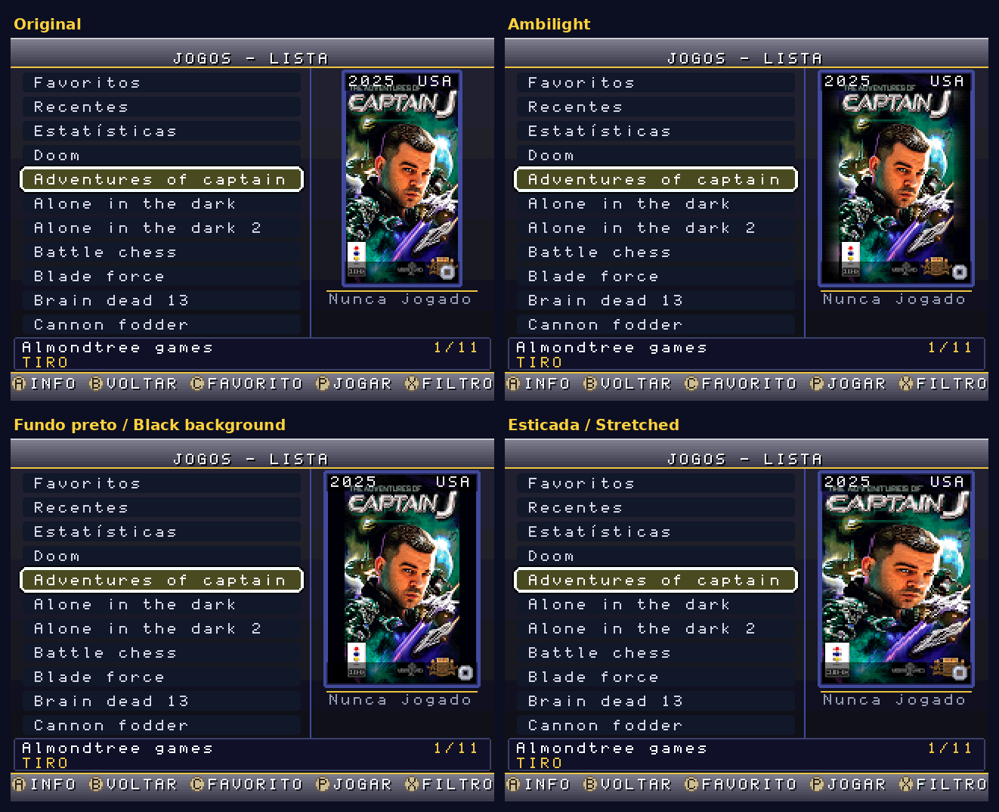</p>

Vale en todas las pantallas (Lista, Portadas, carruseles, Vitrina, Tira, descripción y la portada pequeña del menú principal). En la Lista, la portada siempre empieza a la altura de la primera línea de juegos. Las imágenes se reducen con la media de toda el área de la imagen original, con nitidez leve y sin tramado.

### Vídeo en Cinepak

La vista previa en vídeo usa **Cinepak**, el mismo códec de los juegos de 3DO, con un decodificador propio dentro del menú.

- **Tamaños**: `mini` 80 × 60 · `box` 128 × 96 · `small` 160 × 120 (predeterminado) · `medium` 240 × 180 · `large` 320 × 240.
- **Predeterminado**: 15 fotogramas por segundo, 20 segundos, calidad 4 (de 1 a 31; menor es mejor y más grande).
- **Ya listos**: los vídeos de este repositorio ya están convertidos con esos valores; el generador solo los copia. Quien convierta sus propios vídeos elige el tamaño, los fotogramas por segundo y la duración.
- **Sin sonido**, leído de principio a fin directamente del USB.
- La conversión la hace el generador con **ffmpeg**, un vídeo por núcleo del PC a la vez.
- El vídeo se reproduce en la caja de la lista, en la descripción y a pantalla completa. Cualquier botón lo detiene.

### Textos de los juegos

`.config/3dogamesdetails.ode` contiene el año, el género, el desarrollador, el editor y la descripción de cada juego. Año, género y desarrollador se leen una vez al encender; la descripción se lee cuando se muestra.

---

## 🛠️ Preparar el USB / SD

### Desde el navegador (recomendado)

Abre **[https://cyberrep.github.io/3doode/](https://cyberrep.github.io/3doode/)**, elige tu USB / SD y la página copia el menú, las portadas, las capturas, los vídeos y los textos de tus juegos, ya listos. Funciona en Chrome y Edge en el ordenador, y la propia página tiene el botón **Cómo usar**. 📖 **[Manual de la página, paso a paso](docs/SITE.es.md)**

Para convertir juegos (`.chd`, `.iso`), convertir tus propios vídeos o usar otro navegador, usa el generador de abajo.

### Con el generador (avanzado)


Descargas **un único archivo**. Hace todo lo demás con un asistente paso a paso (la primera pregunta es el idioma):

- **descarga el arte que falte** y genera las **portadas** y las **capturas** en los dos tamaños;
- convierte los **vídeos** a Cinepak;
- genera los **textos de los juegos** (año, género, desarrollador, editor, descripción);
- convierte **`.chd` → `.bin/.cue`** y, si quieres, **`.iso` → `.bin/.cue`**;
- renombra discos con nombre genérico y **organiza** los juegos (en la raíz o en carpetas por letra);
- **copia el `boot.iso`** a la raíz del USB;
- crea el archivo de opciones ya en tu idioma;
- puede **descargar y preparar el firmware** de tu placa.

**Nunca borra** tus archivos.

### Requisitos

- **Python** y, para convertir vídeos, **FFmpeg**. El [manual del generador](docs/MANUAL.es.md) trae los comandos listos para copiar y pegar en PowerShell.

### Paso a paso

1. Ejecuta `py generate_usb.py` y sigue el asistente.
2. Pon el USB en la ODE y enciende la consola.
3. (Opcional) Para instalar el **firmware TADEU** por primera vez: mantén BOOTSEL, conecta el Pico al PC y arrastra el `.uf2` de tu placa a la unidad **RPI-RP2**. Después, las actualizaciones se hacen desde el menú.
4. (Opcional) Instala el **[reloj DS3231](docs/RTC.es.md)**.

El manual completo del generador está en **[docs/MANUAL.es.md](docs/MANUAL.es.md)**.

---

## 📂 Cómo queda el USB / SD

```
boot.iso                 el menú
Juego (USA).iso          tus juegos (.iso o .cue + .bin), en la raíz o en carpetas
covers/small/            portadas hasta 56x78
covers/large/            portadas hasta 100x140
screenshots/medium/      capturas pequeñas
screenshots/large/       capturas grandes (pantalla completa)
videos/                  vistas previas en Cinepak (.cvd)
.config/                 opciones, favoritos, recientes, estadísticas, textos de los juegos,
                         lista guardada y las copias de seguridad (.bak)
saves/                   partidas copiadas de la consola y copias de la NVRAM
roms/                    ROM y RAM extraídas de la consola
firmware/                copia del firmware y el archivo de actualización
```

## 📦 Qué hay en este repositorio

```
boot/        el menú (boot.iso) — siempre la última versión
firmware/    el firmware TADEU (.uf2) para las dos placas
media/       portadas, capturas y vídeos ya convertidos para la tarjeta, y la base de textos de los juegos
tools/       el generador (generate_usb.py, un solo archivo)
docs/        el manual de la página web, el manual del generador y el manual del reloj
```

---

## 🙏 Créditos

Hecho sobre el trabajo de dos personas, a quienes agradezco:

- **[Fixel](https://github.com/fixelsan/3do-ode-firmware)** — la placa ODE y el driver de la ODE.
- **[FCare / SataTo3DO](https://github.com/FCare/SataTo3DO)** — el firmware base, del que nació TADEU.

🏆 **Un agradecimiento especial a MNEMO**, que creó la **primera ODE de la 3DO** y abrió el camino para todas las demás.

También usamos:

- **[libretro-thumbnails](https://github.com/libretro-thumbnails/The_3DO_Company_-_3DO)** — parte de las portadas y capturas que descarga el generador.
- **[3do-devkit](https://github.com/trapexit/3do-devkit)**, de trapexit — el kit de desarrollo con el que se compila el menú.
- **[FFmpeg](https://ffmpeg.org/)** — la conversión de los vídeos a Cinepak.
- **[Pillow](https://python-pillow.org/)** y **[NumPy](https://numpy.org/)** — las imágenes y la conversión de discos en el generador.
- **chdman** (del proyecto MAME) — la conversión de los juegos en `.chd`.
- **Wikipedia** — el editor de cada juego.

### 🧪 Probadores

Gracias a quienes probaron cada versión en una consola de verdad:

- **[NandoGames](https://www.youtube.com/@NandoGamesBrasil)**
- **Luiz Ganso**
- **Otávio Augusto**

El menú se desarrolla desde el **10 de octubre de 2026**. La versión 1.0 se reescribió desde cero en noviembre de 2026.

Los juegos y la BIOS **no** se incluyen.

## 📝 Historial

El historial completo del menú, el firmware y el generador está en **[CHANGELOG.es.md](CHANGELOG.es.md)**.

---

## 💛 Sobre el proyecto

**Hecho con cariño** por uno de los mayores coleccionistas de 3DO de Brasil — años metido en la consola, estudiando y probando cada detalle (con una ayudita de Claude por el camino).

🔧 También estoy trabajando para que funcione en la **ODE de MNEMO**.

☕ **¿Te gusta el proyecto? Puedes apoyarlo con una donación:**

- PayPal: `compras@rodrigotadeu.com.br`
- Pix (clave aleatoria): `7337eb1c-74f0-4d14-97bb-b49ff0265869`

## ⚖️ Licencia

**Uso personal y gratuito.** No está permitido modificar, descompilar, hacer ingeniería inversa, vender (ni entregar junto con un producto que se vende) o usar este proyecto para entrenar inteligencia artificial. El texto completo está en **[LICENSE.md](LICENSE.md)**; las partes hechas por otras personas y sus licencias están en **[THIRD-PARTY.md](THIRD-PARTY.md)**.

Los medios (portadas, capturas, vídeos) provienen de colecciones públicas y son para uso personal.
