# 🎮 3DO ODE — Menu, Firmware and Media

**English** · [Português](README.pt.md) · [Español](README.es.md)

Menu (`boot.iso`), firmware and card generator for the **SataTo3DO ODE** (RP2040 board) of the 3DO, by **Rodrigo Tadeu "CyberRep"**. The menu comes in **3 languages** (English, Portuguese, Spanish), runs in **NTSC and PAL** and works on **both firmwares**: the factory one and ours, **TADEU**.

> 💿🔥 **NEW AND EXCLUSIVE — PLAY YOUR ORIGINAL CDs WITH THE XPORT PLUGGED IN, STRAIGHT FROM THE MENU!** Anyone using the expansion board (Xport) has always had to **power off and pull the board out** to play a real disc: the Xport factory menu cannot do it. Now the menu shows a **CD** tile on the main screen: press **A**, open and close the lid, and the 3DO **restarts by itself into your disc**. Nothing to unplug. [How it works](#-real-cds-on-the-xport-without-removing-the-board).

> ⏰ **The first 3DO ODE in the world with a real-time clock (RTC).** With a cheap DS3231 module soldered to 4 points, your 3DO shows the date, the time and the temperature, and remembers when each game was played. [See how to install it](docs/RTC.md).

> 🌐 **Prepare your USB / SD in the browser, nothing to install:** **[https://cyberrep.github.io/3doode/](https://cyberrep.github.io/3doode/)** (Chrome or Edge on a computer).

> **In 1 minute:** run **`generate_usb.py`** — a **single file** that does everything else: it downloads the art, converts covers, screenshots and videos, builds the game texts and **copies `boot.iso` (the menu)** to the USB.

**Current versions:** menu **1.0** · firmware **TADEU 1.0.5** · [full history](CHANGELOG.md)

> 🟣 **TADEU** — this badge marks, throughout the text, what **only exists with the TADEU firmware**. Everything without the badge also works on the factory firmware. The menu finds out by itself what your ODE has and **only shows what works**: nothing appears half-done and nothing fails for lack of a feature.

---

## ✨ Highlights

| | |
|---|---|
| 💿🔥 **Real CDs on the Xport** | **Only in this menu.** With the expansion board plugged in, a **CD** tile shows up on the main screen and takes the console to the disc in the drive, without removing the board. [See](#-real-cds-on-the-xport-without-removing-the-board). |
| ⏰ **Real-time clock** 🟣 **TADEU** | Date, time and temperature on screen and "played on" for each game. The clock is **detected automatically**: without the module, nothing appears and nothing changes. [Installing the DS3231](docs/RTC.md). |
| 🎨 **Fully customizable** | You build your own menu: 6 view modes, 9 backgrounds, what appears on each screen, the list order, the screen the console starts on. [See everything](#-your-way). |
| 🕹️ **Recognizes your console** | Reads the BIOS and shows the picture of your machine: Panasonic FZ-1, FZ-10, GoldStar or Sanyo TRY, with region and NTSC/PAL. |
| 🔌 **Works on both firmwares** | You do not need to change the firmware to use the menu. With TADEU it gets faster and gains the features with the 🟣 badge. |
| 💿 **One `boot.iso` for everything** | The same file serves the internal ODE and the expansion board (Xport), in NTSC and PAL. |

### 🟣 What only the TADEU firmware does

| | |
|---|---|
| ⚡ **Fast game list** | Games are recognized without opening each file. A game at the end of the USB starts in 2 to 4 s instead of about 30 s. |
| 📊 **USB or SD space** | Size and free space of the media, as a bar, on the main menu. |
| 📁 **Folder creation** | The console creates the folders it needs by itself (`.config`, `saves`, `roms`, `firmware`). |
| ⏰ **Real-time clock** | Date, time and temperature, with the DS3231 module. Detected automatically. |
| 🗓️ **Files with date and time** | Everything the console writes to the USB gets the right date. |
| 💾 **Firmware backup** | Copies the ODE firmware to the USB, from the menu. |
| 🔄 **Update from the menu** | Writes the new firmware without opening the console and without a PC, checking it before applying. |
| 🛟 **Always recoverable** | If something goes wrong, BOOTSEL and a `.uf2` fix it. |

The menu shows what your ODE has in *Options → ODE Device → Features*:

<table>
<tr>
<td align="center"><b>With the TADEU firmware</b><br>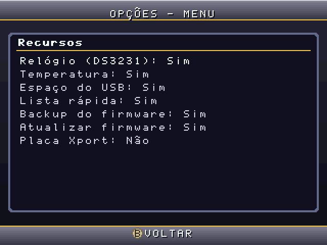</td>
<td align="center"><b>With the factory firmware</b><br>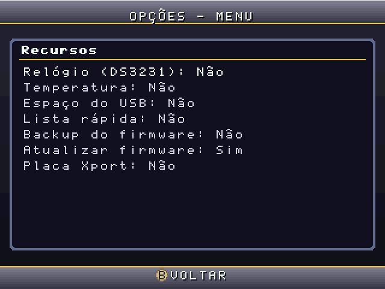</td>
</tr>
</table>

## 📋 Everything it does

| | |
|---|---|
| 🖼️ **6 view modes** | List, Covers, Carousel, Carousel FX, Showcase and Strip. |
| 🎬 **Video preview** | **Cinepak** video, in the list, in the description and full screen. |
| ⭐ **Favorites, Recent and Statistics** | Ranking of the most played games and a play counter. With the clock, also the date and time of each play. |
| 🔎 **Filter and sorting** | Filter by genre and country; sort by name, year, genre, developer or most played. |
| 💿 **Automatic multi-disc** | Start disc 1 and the others are queued by themselves. |
| 📊 **USB or SD space** 🟣 **TADEU** | A bar with the size and free space of the media on the main menu, next to the NVRAM bar. |
| 🔀 **USB or SD, by itself** | On the expansion board (Xport), the menu finds out whether the media is a USB stick or a microSD card and changes every text: "USB" becomes "SD". |
| 💾 **Saves** | Save manager console ↔ USB, backup and restore of the whole NVRAM. |
| 🧰 **Console tools** | Test of up to 8 controllers, picture adjustment, ROM and RAM extraction, full information. |
| 🔄 **Firmware from the console** 🟣 **TADEU** | Backup and update of the ODE firmware without opening the machine and without a PC. |
| 🎵 **Sound** | Sound effects, 10 background tracks and a volume bar. |
| 🌐 **3 languages** | English, Português and Español, switched on the spot. |
| 🛠️ **A single file to prepare the USB** | `generate_usb.py` downloads the art, converts everything and copies the menu. |

---

## 📸 Screens

<table>
<tr>
<td align="center"><b>Main menu</b><br>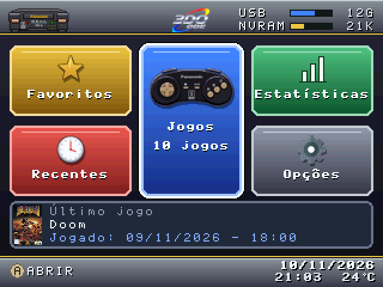</td>
<td align="center"><b>Game description</b><br>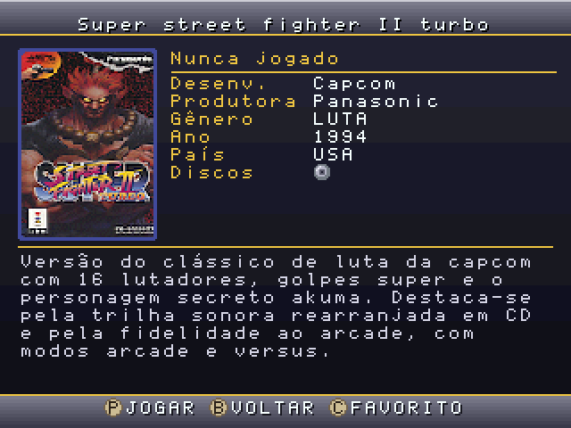</td>
</tr>
<tr>
<td align="center"><b>List</b><br>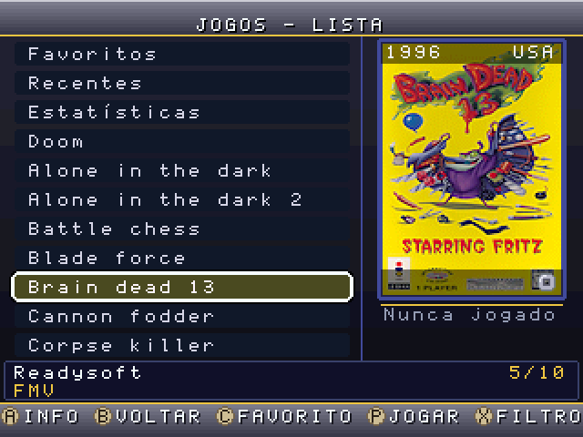</td>
<td align="center"><b>Covers</b><br>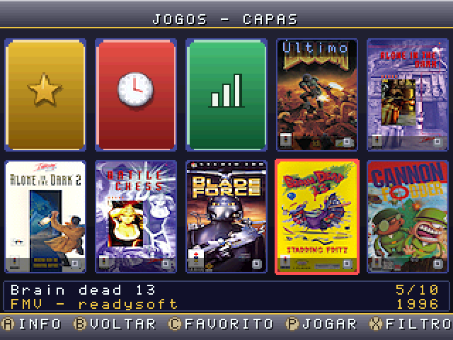</td>
</tr>
<tr>
<td align="center"><b>Carousel</b><br>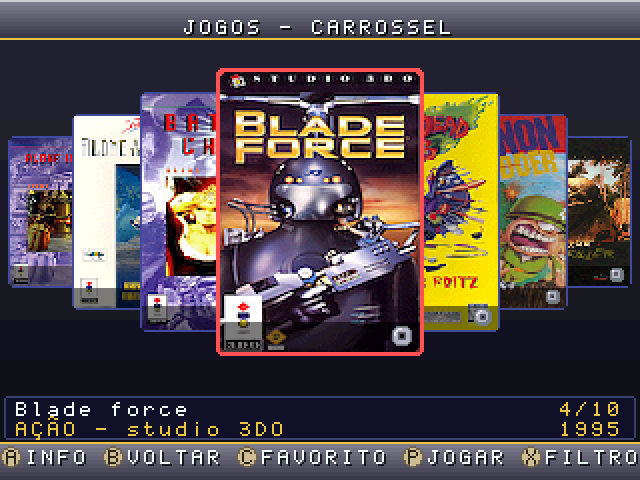</td>
<td align="center"><b>Carousel FX</b><br>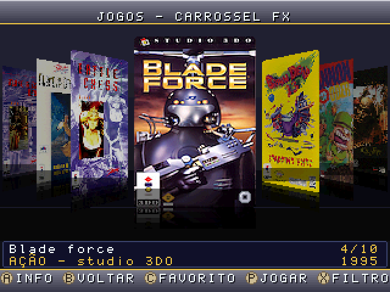</td>
</tr>
<tr>
<td align="center"><b>Showcase</b><br>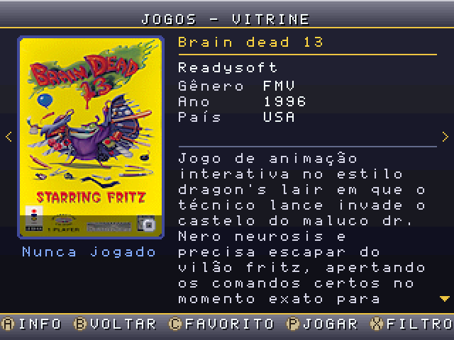</td>
<td align="center"><b>Strip</b><br>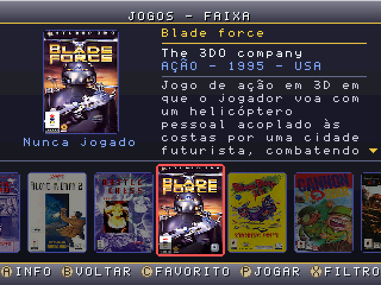</td>
</tr>
<tr>
<td align="center"><b>Options</b><br>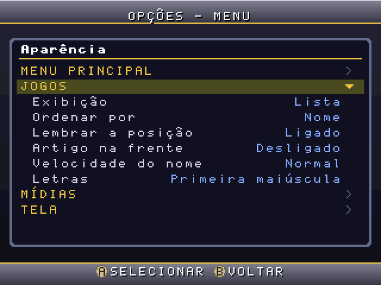</td>
<td align="center"><b>Filter</b><br>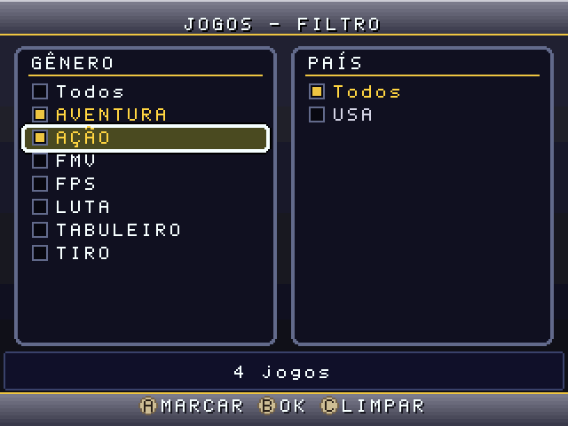</td>
</tr>
<tr>
<td align="center"><b>Statistics</b><br>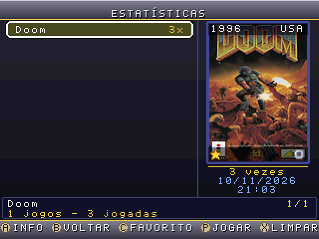</td>
<td align="center"><b>Console information</b><br>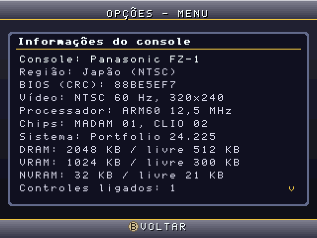</td>
</tr>
</table>

The screens above are in Portuguese; the menu shows them in the language you choose.

---

## 🎨 Your way

The menu is **fully customizable**. Everyone makes the 3DO look the way they want, and everything is saved to the USB automatically.

| What you choose | Options |
|---|---|
| **How to see the games** | 6 modes: List, Covers, Carousel, Carousel FX, Showcase, Strip. |
| **The background** | 9 backgrounds: Default, Carbon fibre, Brushed steel, Honeycomb, Stripes, Grid, Plate, Vignette, Dots. |
| **What appears on the main menu** | Favorites, Recent, Statistics and Last game: on the menu, inside Games, in both or in neither. |
| **The information on screen** | Time, date, temperature, USB space and NVRAM space: each can be shown or hidden. |
| **Where the console starts** | Main menu, Games, Favorites or Recent. |
| **The list order** | Name, year, genre, developer or most played; with or without the article in front; remembering the last position or not. |
| **What appears next to the list** | Nothing, the cover, the screenshot or the video of the game. |
| **What the description shows** | 10 combinations of cover, screenshot and video. |
| **The texts** | UPPERCASE, lowercase or Capitalized; 5 speeds for long names; 3 languages. |
| **The sound** | Effects on or off, 10 tracks or a random one, volume bar. |
| **The rest** | Screen saver after 1, 3, 5 or 10 minutes, or off. |
| **The clock** | 12 or 24 hours. |

And so you never lose anything: **backup and restore** of the settings, favorites, recent games and statistics, and a button to **restore the defaults**.

---

## ⏰ Real-time clock (RTC)

🟣 **TADEU** 1.0.5 or newer, with the DS3231 module.

The 3DO never had a clock. With the **TADEU 1.0.5** firmware and a **DS3231** module wired to the ODE's Pico, it gets:

- **Date, time and temperature** on the main menu (each can be hidden in Options).
- **"Played: mm/dd/yyyy - hh:mm"** on the last game panel, in Recent and in Statistics.
- **Files with the right date** on the USB: NVRAM backups get the date and time in their name.
- **Setting the clock on the console itself**, in *Options → ODE Device → Date and time*, in 12 or 24 hours.
- **Low battery warning**: if the clock lost the time, the menu tells you at power-on and offers to set it.
- **Format per language**: month/day/year and °F in English; day/month/year and °C in Portuguese and Spanish.

It takes **4 wires** on the Pico. The step by step, with the pin drawing, is in **[docs/RTC.md](docs/RTC.md)**.

<p align="center">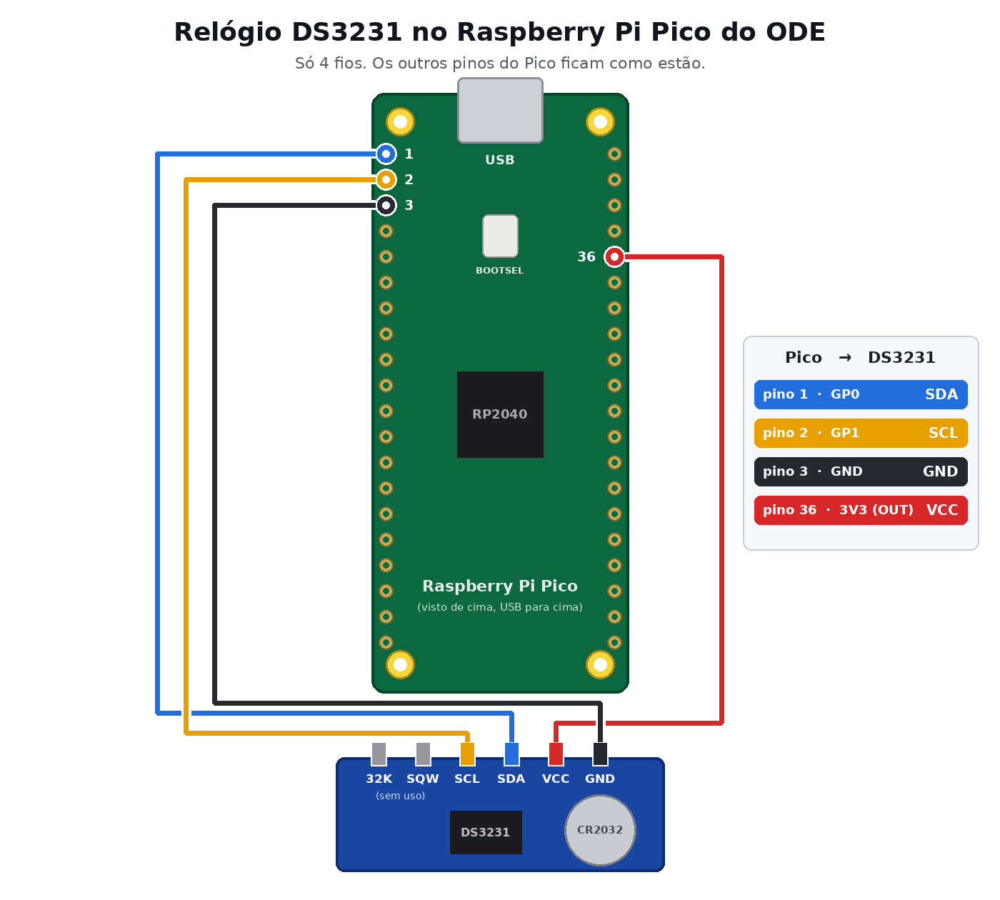</p>

### Automatic clock detection

At power-on, the menu asks the ODE whether a clock exists and whether it has the right time.

- **With the module installed**: date, time and temperature appear, and the clock options show up in the menu.
- **Without the module** (or on the factory firmware): **nothing appears and nothing changes**. No zeroed clock, no error message, no dead option: the menu stays exactly as it always was.
- **With the module and a low battery**: the menu warns once, at power-on, and offers to set the time.

To check: *Options → ODE Device → Features* shows **Clock (DS3231): Yes** or **No**.

---

## 🕹️ Automatic console detection

At power-on, the menu reads a 256-byte slice of the BIOS, computes its signature and finds out which machine it is running on. It is instant (reading the whole BIOS would take about 8 seconds).

| Console | Recognized regions |
|---|---|
| **Panasonic FZ-1** | USA, Japan, Europe (PAL), development units |
| **Panasonic FZ-10** | USA, Japan, Europe (PAL) |
| **GoldStar** | USA |
| **Sanyo TRY** | Japan |

With that the menu:

- shows the **picture of your console** at the top of the main menu and on the firmware update success screen;
- reports console, region, BIOS signature, video system, chips, free memory, connected controllers and FMV module in *Options → 3DO Console → Console information*;
- only offers the **FMV ROM** extraction if the module exists.

**NTSC or PAL** is asked from the system, and the screen adjusts by itself. A BIOS revision that is not in the table yet appears as "Unknown" and the menu works normally, just without the picture.

---

## 🔌 The two firmwares

The SataTo3DO ODE has a firmware on its RP2040 board. There are two:

- **Factory** — the one that comes on the board.
- **TADEU (ours)** — optional. Makes everything **much faster** and turns on the new features.

The **menu runs on both**: at power-on it asks the ODE which firmware and version is there, and only shows what that firmware can do. Nothing hangs for lack of a feature.

| Feature | Factory | TADEU |
|---|:---:|:---:|
| Full menu, 6 views, video, favorites, statistics, saves | ✅ | ✅ |
| Fast game list (a game at the end of the USB starts in 2–4 s instead of ~30 s) | — | ✅ |
| Creating folders on the USB from the console | — | ✅ |
| USB free space on the menu | — | ✅ (1.0.4+) |
| Firmware backup from the console | — | ✅ |
| Firmware update from the menu | — | ✅ |
| Clock, date, time and temperature (with the DS3231) | — | ✅ (1.0.5) |
| Files written with date and time | — | ✅ (1.0.5) |

Check what your ODE has in *Options → ODE Device → Features*. Everything that depends on TADEU carries the 🟣 badge in this document.

<table>
<tr>
<td align="center"><b>ODE information — TADEU</b><br>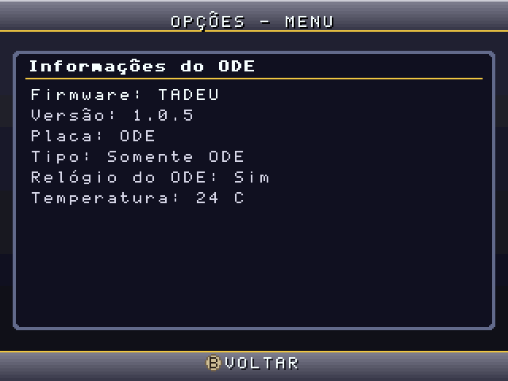</td>
<td align="center"><b>ODE information — factory</b><br>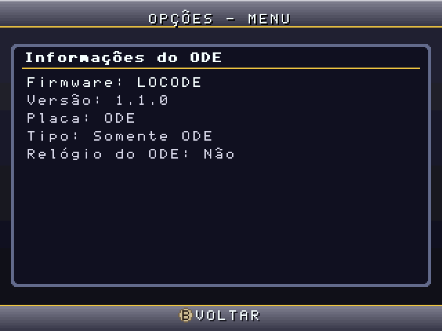</td>
</tr>
</table>

### 🟣 What TADEU changes inside

- **List by extension**: games are recognized by `.cue` and `.iso` without opening each file. The real check is left for when you play.
- **Incremental paging**: moving through the list continues from where it stopped, instead of restarting the folder on every page.
- **Folder creation** (`.config/`, `saves/`, `roms/`, `firmware/`).
- **Firmware backup**: copies the Pico flash to the USB, verified byte by byte.
- **Fail-safe update**: the new firmware goes to a staging area, is verified by CRC and only then applied. If anything goes wrong, the current firmware is still there.
- **Always recoverable**: hold BOOTSEL, plug the Pico into a PC and drag a `.uf2`.
- **Chip serial number**: the firmware can report the Pico's unique identifier.
- **USB space** (size and free).
- **DS3231 clock**: date, time, temperature and battery state.
- **One source code for both boards**: the original (RP2040-Plus, 4 MB) and the clone with a regular Pico (2 MB).

### ODE only or ODE + CD-ROM

The menu detects by itself how many drives exist and shows it in *ODE information* as **"ODE only"** or **"ODE + CD-ROM"**. When installing the firmware, use the `.uf2` for **your board**: flashing the other one leaves a black screen after the logo (just flash the right one again through BOOTSEL).

### Expansion board (Xport)

The **same `boot.iso`** works on the expansion-port ODE. The menu recognizes the board and applies the memory fix it needs.

**USB or SD, by itself:** the board takes a USB stick or a microSD card. The menu finds out which one is in use and changes the texts of the whole system: "Reading the USB" becomes "Reading the SD", "USB information" becomes "SD information", and so on.

### 💿 Real CDs on the Xport, without removing the board

> **The big highlight of this version.** The Xport sits on the expansion port and the console's CD drive is still there, but the console always boots from the Xport. Until now, playing an original disc meant powering off and pulling the board out: the Xport factory menu has no such function. **This menu does.**

<p align="center">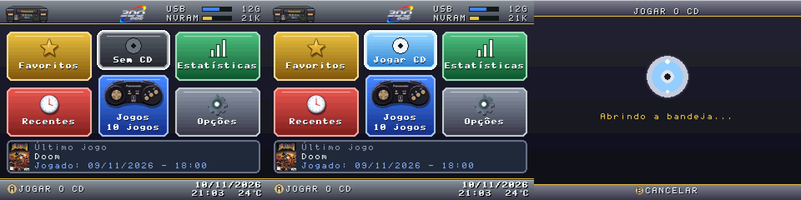</p>

How it works:

1. With the Xport plugged in, the main screen gains the **CD** tile, above **Games**. It is **dark gray** when the drive is empty and **light blue** when there is a disc. (On the internal ODE the tile does not appear: there is no CD drive there.)
2. Select the tile and press **A**. The menu saves your lists, stops the music and takes the Xport off the port.
3. **Panasonic FZ-10 (lid):** the screen asks **"Open the CD lid"** and then **"Close the CD lid"**. You can swap the disc at that moment.
   **Tray consoles (FZ-1, GoldStar, Sanyo):** the menu tells the drive to open and close the tray by itself; if the drive does not obey, the screen asks you to press the tray button.
4. The screen shows **"Loading the CD..."** and the console **restarts by itself into the game on the disc**.

**B** cancels at any step. If the disc does not start, the Xport goes back on the port and the menu carries on. To return to the menu after playing the CD, power the console off and on.

> **Test status:** the switch was confirmed on real hardware on the **Panasonic FZ-10** (opening and closing the lid takes the console to the disc). Automatic **tray** opening on the other models and this first in-menu version are still being tested: if something does not work on your console, [let me know](../../issues).

### Game description: you choose what is shown

The **game name sits on the top bar** (it scrolls slowly when longer than the bar). Below comes the **game sheet**: "Played: 2x - Last 10/11/2026", **developer**, **publisher**, genre, year, country and discs (one icon per disc). In *Options > Appearance > Description* each of these can be **shown or hidden**. Text longer than the space **scrolls by itself**, and scrolling the description does not stop the video.

The layout follows the images chosen in *Media > Description*: with **one image**, it sits on the left and the sheet on the right; with **two**, both go to the left and the sheet and text to the right; with **three** (cover, screenshot and video), the images go on top.

<p align="center">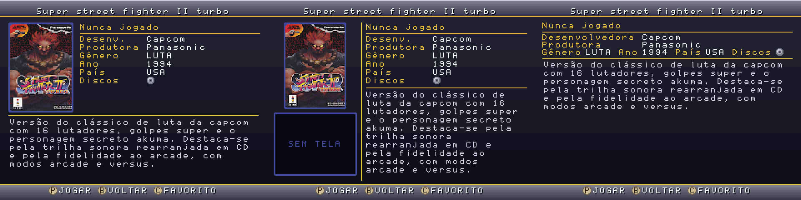</p>

---

## 📺 The menu

### Main menu

Five tiles: **Favorites**, **Games**, **Statistics**, **Recent** and **Options**, and below them the **Last game** panel, with the cover, the name and when it was played.

- At the top: the console picture and the **NVRAM** space bar (the console's saves).
- 🟣 **TADEU** Next to it, the **USB or SD space** bar, with size and free space.
- 🟣 **TADEU** At the bottom: **date, time and temperature** (with the clock installed).
- On the last game panel: **A** opens the description, **P** plays right away.
- Favorites, Recent, Statistics and Last game can appear on the menu, inside Games, in both or in neither.
- You can choose which screen the console starts on: Main menu, Games, Favorites or Recent.

### 🖼️ The 6 view modes

Choose in *Options → Appearance → Games → View*.

| Mode | What it looks like |
|---|---|
| **List** | Names on the left; on the right the cover, the screenshot or the **video** of the game, with year, country, discs and favorite. |
| **Covers** | A grid of covers, the selected one with a red border. |
| **Carousel** | A large cover in the centre and smaller neighbours on the sides. |
| **Carousel FX** | The carousel in perspective, with a floor reflection and animation. |
| **Showcase** | A large cover on the left and, next to it, publisher, developer, genre, year, country and the whole **description**. |
| **Strip** | The **game screenshot** and the description on top; below, a sliding row of covers. |

In all of them: a translucent strip on the cover with one icon per disc and the favorite star, and a CD in place of a missing cover.

### Buttons

| Where | Buttons |
|---|---|
| **Main menu** | D-pad selects · **A** opens · **P** plays the last game |
| **Games** | **A** description · **B** back · **C** favorite · **P** play · **X** filter · **L / R** jump to the previous / next letter |
| **Showcase and Strip** | ◄ ► change game · ▲ ▼ scroll the description |
| **Description** | **P** play · **B** back · **C** favorite · **X** video or screenshot full screen · ◄ ► previous / next game · ▲ ▼ scroll the text |
| **Favorites** | **A** description · **B** back · **C** remove from favorites · **P** play |
| **Recent and Statistics** | Same as Games, with **X** to clear the list |
| **Filter** | **A** tick · **C** clear · **B** apply and go back |
| **Options** | ▲ ▼ move · ◄ ► or **A** change · **B** back |

Holding the D-pad speeds up scrolling.

### The game list

- **A single list, in alphabetical order**: games in subfolders (up to 3 levels) go into the same list.
- **Sorting**: by name, year, genre, developer or most played. **L / R** jumps from group to group (letter, year, genre…).
- **Article in front**: shows "The Need for Speed" instead of "Need for Speed, The".
- **Multi-disc**: the discs of a game become a single entry. When you play, all of them are queued on the ODE.
- **Remember the position**: when opening Games, the selection returns to the last game played.
- **Saved list**: the menu can keep the game list and start much faster (*Read at power-on*: Yes, Only if there are new ones, No).
- **Long names** scroll by themselves, at 5 speeds.
- **Game formats**: `.iso` and `.cue` + `.bin`. The generator converts `.chd` on the PC.

### Game description

Cover, screenshot and video of the game (you choose the combination among 10), genre, year, country, developer and the full description. **X** opens the video or the screenshot full screen.

### Game starting

When you press **P** the game card appears: cover, name, genre, year and country, how many times it was played and, for multi-disc games, "N discs added to the queue".

### ⭐ Favorites, 🕑 Recent and 📊 Statistics

- **Favorites**: **C** marks and unmarks, with the star animation and sound.
- **Recent**: the latest games. 🟣 **TADEU** With the clock, also the date and time of each one.
- **Statistics**: ranking of the most played, with the total of games and plays.
- Everything is kept on the USB, in `.config/`, and is part of the settings backup.

### 🔎 Filter

**X** on the game list opens two columns, **Genre** and **Country**. Tick as many as you like in each; the bottom shows how many games pass the filter.

---

## ⚙ Options — the whole menu

Click each section to open it. Everything is saved to the USB automatically (`.config/3doconfig.ode`).

<details>
<summary><b>🎨 Appearance</b></summary>

On the console this section is an accordion: open one group at a time.

<details>
<summary>Main menu</summary>

| Option | Values | What it does |
|---|---|---|
| Favorites | Menu and Games · Main Menu · Games · Off | Where the Favorites entry appears. |
| Recent | same | Where Recent appears. |
| Statistics | same | Where Statistics appears. |
| Last played | same | The last game panel on the menu and the "Last" entry at the top of Games. |
| Time | Show · Hide | 🟣 **TADEU** Only appears with the clock. |
| Date | Show · Hide | 🟣 **TADEU** Only appears with the clock. |
| Temperature | Show · Hide | 🟣 **TADEU** Only appears with the clock. |
| USB space | Show · Hide | 🟣 **TADEU** 1.0.4 or newer. |
| NVRAM space | Show · Hide | The console's save memory. |
| Start screen | Main menu · Games · Favorites · Recent | Where the console starts. |

</details>

<details>
<summary>Games</summary>

| Option | Values | What it does |
|---|---|---|
| View | List · Covers · Carousel · Carousel FX · Showcase · Strip | How the games are shown. |
| Sort by | Name · Year · Genre · Developer · Most played | The list order. |
| Remember the position | On · Off | Opens Games on the last game played. |
| Article in front | On · Off | "The Need for Speed" instead of "Need for Speed, The". |
| Name speed | Very slow · Slow · Normal · Fast · Very fast | Scrolling of long names. |
| Letters | UPPERCASE · lowercase · Capitalized | How texts are written. |

</details>

<details>
<summary>Media</summary>

| Option | Values | What it does |
|---|---|---|
| List | Off · Cover · Screenshot · Video | What appears next to the list (List mode only). |
| Description | Off · Cover · Cover + Screenshot · Cover + Screenshot + Video · Cover + Screenshot / Video · Cover + Video · Screenshot · Screenshot + Video · Screenshot / Video · Video | What the description screen shows. |

</details>

<details>
<summary>Screen</summary>

| Option | Values | What it does |
|---|---|---|
| Theme | 3DO | The colour theme. |
| Background | Default · Carbon fibre · Brushed steel · Honeycomb · Stripes · Grid · Plate · Vignette · Dots | The background of every screen. |
| Screen saver | Off · 1 · 3 · 5 · 10 minutes | The 3DO logo and the consoles drifting across the screen. |

</details>

</details>

<details>
<summary><b>🎵 Audio</b></summary>

| Option | Values | What it does |
|---|---|---|
| Sound effects | On · Off | Sounds for moving, going back, favoriting. |
| Background music | Off · Órbita · Pixel Rush · Neon Drive · Nebulosa · Arcade · Deserto · Templo · Horizonte · Caravana · Aurora · Random | 10 tracks, or one picked at random each time you power on. |
| Music volume | Bar from 0 to 10 | Changes on the spot, with the music playing. |

</details>

<details>
<summary><b>💾 Storage and Saves</b></summary>

| Item | What it does |
|---|---|
| **Storage manager** | Two tabs, **Console (NVRAM)** and **USB (saves/)**. Copies one save or all of them from one side to the other and deletes saves from the console. **L / R** switches tabs. |
| **Back up the NVRAM** | Copies the whole save memory (32 KB) to `saves/`. 🟣 **TADEU** With the clock, the file gets the date and time in its name. |
| **Restore the NVRAM backup** | Puts the last backup back into the console. |
| **NVRAM diagnostics** | Space used, saves and whether the memory is formatted. |

</details>

<details>
<summary><b>🔌 ODE Device</b></summary>

| Item | What it does |
|---|---|
| **ODE information** | Firmware, version, board, type (ODE only or ODE + CD-ROM), clock and temperature. |
| **Features** | Says "Yes" or "No" for each feature of your ODE: clock, temperature, USB space, fast list, backup and update. |
| **USB information** | Games, discs, covers in memory and read speed. 🟣 **TADEU** Also the size and free space. |
| **Read the USB again** | Reads the game list again. |
| **Read at power-on** | Yes · Only if there are new ones · No. With the saved list the console starts faster. |
| **Firmware backup** 🟣 **TADEU** | Copies the ODE firmware to `firmware/` on the USB. |
| **Update firmware** 🟣 **TADEU** | Writes `firmware/update.ode` (or `.uf2`, or `.3do`), shows the percentage and asks you to turn the console off and on. |
| **Date and time** 🟣 **TADEU** | Only appears with the clock. Sets the date and time and chooses 12 or 24 hours. |
| **Test the ODE and the USB** | Diagnostics with read and cover timings; writes a report to the USB. |

</details>

<details>
<summary><b>🕹️ 3DO Console</b></summary>

| Item | What it does |
|---|---|
| **Console information** | Console, region, BIOS signature, video, processor, chips, system, DRAM, VRAM, NVRAM, connected controllers, FMV module, music and covers in memory. |
| **Picture adjustment** | Test pattern with a grid, colour bars and the border of the visible area. |
| **Controller test** | A picture of the controller; each button lights up in the colour of whoever pressed it. **Up to 8 controllers**, each with its own colour. Hold A + B + C for 5 s to leave. |
| **System ROM** | Saves the console BIOS to `roms/`. |
| **Font ROM** | Saves the font ROM to `roms/`. |
| **FMV ROM** | Only appears if the FMV module is connected. |
| **RAM** | Saves the RAM to `roms/`. |

Saving shows the percentage on the bar and, at the end, the size and the time taken.

</details>

<details>
<summary><b>🌐 General</b></summary>

| Item | What it does |
|---|---|
| **Language** | Português · Español · English. Switches on the spot. |
| **About** | Menu version, ODE firmware and version, and the acknowledgements. |
| **Back up the settings** | Saves to the USB a copy of the settings, recent games, favorites and statistics. |
| **Restore the backup** | Brings the saved copy back. |
| **Restore the defaults** | Returns the options to their defaults. Favorites, recent games and statistics do not change. |

</details>

---

## 🎬 Media: covers, screenshots and video

Everything is prepared on the PC by `generate_usb.py` and lives **in the root of the USB**, with the same name as the game file.

| Folder | Format | Size | Where it appears |
|---|---|---|---|
| `covers/small/` | 16-bit CEL | 56 × 78 | Covers grid and last game panel |
| `covers/large/` | 16-bit CEL | 100 × 140 | List, carousels, Showcase, Strip and description |
| `screenshots/medium/` | 16-bit CEL | up to 120 × 90 | List, Strip and description |
| `screenshots/large/` | 16-bit CEL | up to 304 × 228 | Full screen (X on the description) |
| `videos/` | **Cinepak** (`.cvd`) | 80 × 60 to 320 × 240 | List, description and full screen |

### Cinepak video

The video preview uses **Cinepak**, the same codec as 3DO games, with its own decoder inside the menu.

- **Sizes**: `mini` 80 × 60 · `box` 128 × 96 · `small` 160 × 120 (default) · `medium` 240 × 180 · `large` 320 × 240.
- **Default**: 15 frames per second, 20 seconds, quality 4 (from 1 to 31; lower is better and bigger).
- **Ready-made**: the videos in this repository are already converted with these defaults; the generator only copies them. If you convert your own videos, you choose the size, frames per second and length.
- **No sound**, read from start to end straight from the USB.
- Conversion is done by the generator with **ffmpeg**, one video per PC core at a time.
- The video plays in the list box, in the description and full screen. Any button stops it.

### Game texts

`.config/3dogamesdetails.ode` holds the year, genre, developer, publisher and description of each game. Year, genre and developer are read once at power-on; the description is read when it is shown.

---

## 🛠️ Preparing the USB / SD

### In the browser

Open **[https://cyberrep.github.io/3doode/](https://cyberrep.github.io/3doode/)**, choose your USB / SD and the page copies the menu, covers, screenshots, videos and texts for your games, ready to use. It works in Chrome and Edge on a computer. To convert games (`.chd`, `.iso`) or to use another browser, use the generator below.

### With the generator


You download **a single file**. It does everything else with a step-by-step wizard (the first question is the language):

- **downloads the missing art** and builds the **covers** and **screenshots** in both sizes;
- converts the **videos** to Cinepak;
- builds the **game texts** (year, genre, developer, publisher, description);
- converts **`.chd` → `.bin/.cue`** and, if you want, **`.iso` → `.bin/.cue`**;
- renames discs with generic names and **organizes** the games (in the root or in folders by letter);
- **copies `boot.iso`** to the root of the USB;
- creates the options file already in your language;
- can **download and prepare the firmware** for your board.

It **never deletes** your files.

### Requirements

- **Python** and, to convert videos, **FFmpeg**. The [generator manual](docs/MANUAL.md) has the commands ready to copy and paste into PowerShell.

### Step by step

1. Run `py generate_usb.py` and follow the wizard.
2. Put the USB in the ODE and turn the console on.
3. (Optional) To install the **TADEU firmware** for the first time: hold BOOTSEL, plug the Pico into the PC and drag the `.uf2` for your board onto the **RPI-RP2** drive. After that, updates are done from the menu.
4. (Optional) Install the **[DS3231 clock](docs/RTC.md)**.

The full generator manual is in **[docs/MANUAL.md](docs/MANUAL.md)**.

---

## 📂 What the USB / SD looks like

```
boot.iso                 the menu
Game (USA).iso           your games (.iso or .cue + .bin), in the root or in folders
covers/small/            56x78 covers
covers/large/            100x140 covers
screenshots/medium/      small screenshots
screenshots/large/       large screenshots (full screen)
videos/                  Cinepak previews (.cvd)
.config/                 options, favorites, recent, statistics, game texts,
                         saved list and the backup copies (.bak)
saves/                   saves copied from the console and NVRAM backups
roms/                    ROMs and RAM extracted from the console
firmware/                firmware backup and the update file
```

## 📦 What is in this repository

```
boot/        the menu (boot.iso) — always the latest version
firmware/    the TADEU firmware (.uf2) for both boards
media/       covers, screenshots and videos already converted for the card, and the game text database
tools/       the generator (generate_usb.py, a single file)
docs/        the generator manual and the clock manual
```

---

## 🙏 Credits

Built on the work of two people, whom I thank:

- **[Fixel](https://github.com/fixelsan/3do-ode-firmware)** — the ODE board and the ODE driver.
- **[FCare / SataTo3DO](https://github.com/FCare/SataTo3DO)** — the base firmware, from which TADEU was born.

🏆 **A special thank you to MNEMO**, who created the **first ODE for the 3DO** and opened the way for all the others.

We also use:

- **[libretro-thumbnails](https://github.com/libretro-thumbnails/The_3DO_Company_-_3DO)** — part of the covers and screenshots the generator downloads.
- **[3do-devkit](https://github.com/trapexit/3do-devkit)**, by trapexit — the development kit the menu is built with.
- **[FFmpeg](https://ffmpeg.org/)** — converting videos to Cinepak.
- **[Pillow](https://python-pillow.org/)** and **[NumPy](https://numpy.org/)** — images and disc conversion in the generator.
- **chdman** (from the MAME project) — converting `.chd` games.
- **Wikipedia** — the publisher of each game.

### 🧪 Testers

Thanks to those who tested every version on a real console:

- **[NandoGames](https://www.youtube.com/@NandoGamesBrasil)**
- **Luiz Ganso**
- **Otávio Augusto**

The menu has been in development since **October 10, 2026**. Version 1.0 was rewritten from scratch in November 2026.

Games and BIOS are **not** provided.

## 📝 History

The full history of the menu, the firmware and the generator is in **[CHANGELOG.md](CHANGELOG.md)**.

---

## 💛 About the project

**Made with love** by one of the biggest 3DO collectors in Brazil — years deep into the console, studying and testing every detail (with a little help from Claude along the way).

🔧 I am also working on running it on **MNEMO's ODE**.

☕ **Enjoying the project? You can support it with a donation:**

- PayPal: `compras@rodrigotadeu.com.br`
- Pix (random key): `7337eb1c-74f0-4d14-97bb-b49ff0265869`

## ⚖️ License

**Free for personal use.** You may not modify, decompile, reverse engineer, sell (or ship with a product that is sold) or use this project to train artificial intelligence. The full text is in **[LICENSE.md](LICENSE.md)**; the parts made by other people and their licenses are in **[THIRD-PARTY.md](THIRD-PARTY.md)**.

The media (covers, screenshots, videos) comes from public collections and is for personal use.
