# 🎮 3DO ODE — Menu, Firmware e Mídias

[English](README.md) · **Português** · [Español](README.es.md)

Menu (`boot.iso`), firmware e gerador de cartão para a **ODE SataTo3DO** (placa RP2040) do 3DO, por **Rodrigo Tadeu "CyberRep"**. O menu está em **3 idiomas** (Português, Inglês, Espanhol), roda em **NTSC e PAL** e funciona nos **dois firmwares**: o de fábrica e o nosso, o **TADEU**.

> 💿🔥 **NOVO E EXCLUSIVO — JOGUE SEUS CDs ORIGINAIS COM O XPORT LIGADO, DIRETO PELO MENU!** Quem usa a placa de expansão (Xport) sempre teve que **desligar o console e tirar a placa** para jogar um disco de verdade: o menu de fábrica do Xport não faz isso. Agora o menu mostra uma caixa **CD** na tela principal: aperte **A**, abra e feche a tampa, e o 3DO **reinicia sozinho no seu disco**. Sem desmontar nada. [Como funciona](#-cd-de-verdade-no-xport-sem-tirar-a-placa).

> ⏰ **O primeiro ODE de 3DO do mundo com relógio de tempo real (RTC).** Com um módulo DS3231 de poucos reais soldado em 4 pontos, o seu 3DO passa a mostrar data, hora e temperatura, e a guardar quando cada jogo foi jogado. [Veja como instalar](docs/RTC.pt.md).

> 🌐 **Prepare o seu USB / SD pelo navegador, sem instalar nada:** **[https://cyberrep.github.io/3doode/](https://cyberrep.github.io/3doode/)** (Chrome ou Edge no computador).

> **Em 1 minuto:** rode o **`generate_usb.py`** — um **único arquivo** que faz todo o resto: baixa a arte, converte capas, telas e vídeos, monta os textos dos jogos e **copia o `boot.iso` (o menu)** para o USB.

**Versões atuais:** menu **1.4** · firmware **TADEU 1.0.6** · [histórico completo](CHANGELOG.pt.md)

> ⚠️ **Vindo da 1.3?** Na 1.4 as capas e as telas mudaram: as capas passaram a ser gravadas **na proporção real** (long box e caixa de CD sem esticar) e as imagens ficaram **mais nítidas e limpas**. As imagens antigas **continuam funcionando** no menu 1.4, mas aparecem como antes (esticadas e granuladas). Para ver a diferença, **grave as mídias de novo**: a [página web](https://cyberrep.github.io/3doode/) troca as capas e telas antigas do cartão sozinha na primeira gravação; no `generate_usb.py` elas são refeitas na primeira execução. Atualize o `boot.iso` junto.

> 🟣 **TADEU** — este selo marca, no texto todo, o que **só existe com o firmware TADEU**. Tudo o que não tem o selo funciona também no firmware de fábrica. O menu descobre sozinho o que o seu ODE tem e **só mostra o que funciona**: nada aparece pela metade nem dá erro por falta de recurso.

---

## ✨ Destaques

| | |
|---|---|
| 💿🔥 **CD de verdade no Xport** | **Exclusivo deste menu.** Com a placa de expansão ligada, uma caixa **CD** aparece na tela principal e leva o console para o disco que está no leitor, sem tirar a placa. [Veja](#-cd-de-verdade-no-xport-sem-tirar-a-placa). |
| ⏰ **Relógio de tempo real** 🟣 **TADEU** | Data, hora e temperatura na tela e "jogado em" de cada jogo. O relógio é **detectado sozinho**: sem o módulo, nada aparece e nada muda. [Instalação do DS3231](docs/RTC.pt.md). |
| 🎨 **Totalmente customizável** | Você monta o seu menu: 6 modos de exibição, 9 fundos, o que aparece em cada tela, a ordem da lista, a tela em que o console liga. [Veja tudo](#-do-seu-jeito). |
| 🕹️ **Reconhece o seu console** | Lê a BIOS e mostra a foto do seu aparelho: Panasonic FZ-1, FZ-10, GoldStar ou Sanyo TRY, com região e NTSC/PAL. |
| 🔌 **Funciona nos dois firmwares** | Não precisa trocar o firmware para usar o menu. Com o TADEU ele fica mais rápido e ganha os recursos com o selo 🟣. |
| 💿 **Um `boot.iso` para tudo** | O mesmo arquivo serve ao ODE interno e à placa de expansão (Xport), em NTSC e PAL. |

### 🟣 O que só o firmware TADEU faz

| | |
|---|---|
| ⚡ **Lista de jogos rápida** | Os jogos são reconhecidos sem abrir cada arquivo. Um jogo do fim do USB abre em 2 a 4 s, em vez de cerca de 30 s. |
| 📊 **Espaço do USB ou SD** | Tamanho e espaço livre da mídia, em barra, no menu principal. |
| 📁 **Criação de pastas** | O console cria sozinho as pastas de que precisa (`.config`, `saves`, `roms`, `firmware`). |
| ⏰ **Relógio de tempo real** | Data, hora e temperatura, com o módulo DS3231. Detectado sozinho. |
| 🗓️ **Arquivos com data e hora** | Tudo o que o console grava no USB sai com a data certa. |
| 💾 **Backup do firmware** | Copia o firmware do ODE para o USB, pelo menu. |
| 🔄 **Atualização pelo menu** | Grava o firmware novo sem abrir o console e sem PC, com conferência antes de aplicar. |
| 🛟 **Sempre recuperável** | Se algo der errado, o BOOTSEL e um `.uf2` resolvem. |

O menu mostra o que o seu ODE tem em *Opções → Dispositivo ODE → Recursos*:

<table>
<tr>
<td align="center"><b>Com o firmware TADEU</b><br>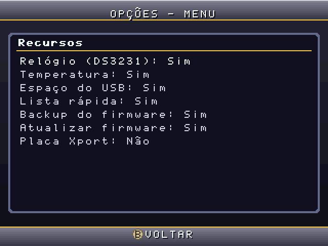</td>
<td align="center"><b>Com o firmware de fábrica</b><br>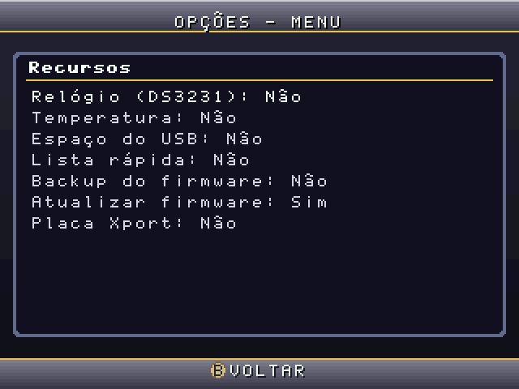</td>
</tr>
</table>

## 📋 Tudo o que ele faz

| | |
|---|---|
| 🖼️ **6 modos de exibição** | Lista, Capas, Carrossel, Carrossel FX, Vitrine e Faixa. |
| 🎬 **Prévia em vídeo** | Vídeo em **Cinepak**, na lista, na descrição e em tela cheia. |
| ⭐ **Favoritos, Recentes e Estatísticas** | Ranking dos mais jogados e contador de partidas. Com o relógio, também a data e a hora de cada partida. |
| 🔎 **Filtro e ordenação** | Filtra por gênero e país; ordena por nome, ano, gênero, produtora ou mais jogados. |
| 💿 **Multi-disco automático** | Inicie o disco 1 e os outros entram na fila sozinhos. |
| 📊 **Espaço do USB ou SD** 🟣 **TADEU** | Barra com o tamanho e o espaço livre da mídia no menu principal, ao lado da barra da NVRAM. |
| 🔀 **USB ou SD, sozinho** | Na placa de expansão (Xport), o menu descobre se a mídia é um pendrive ou um cartão microSD e troca todos os textos: "USB" vira "SD". |
| 💾 **Saves** | Gerenciador de saves console ↔ USB, backup e restauração da NVRAM inteira. |
| 🧰 **Ferramentas do console** | Teste de até 8 controles, ajuste de imagem, extração de ROMs e RAM, informações completas. |
| 🔄 **Firmware pelo console** 🟣 **TADEU** | Backup e atualização do firmware do ODE sem abrir o aparelho e sem PC. |
| 🎵 **Som** | Efeitos sonoros, 10 músicas de fundo e volume em barra. |
| 🌐 **3 idiomas** | Português, Español e English, trocados na hora. |
| 🛠️ **Um arquivo só para preparar o USB** | O `generate_usb.py` baixa a arte, converte tudo e copia o menu. |

---

## 📸 Telas

<table>
<tr>
<td align="center"><b>Menu principal</b><br>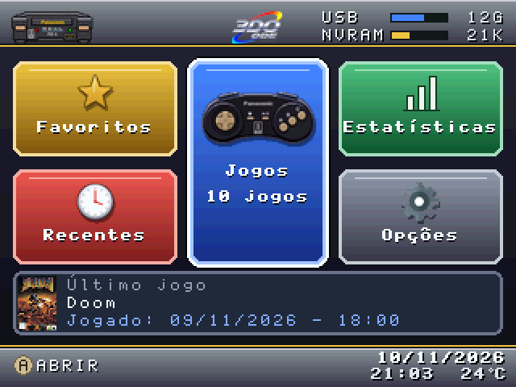</td>
<td align="center"><b>Descrição do jogo</b><br>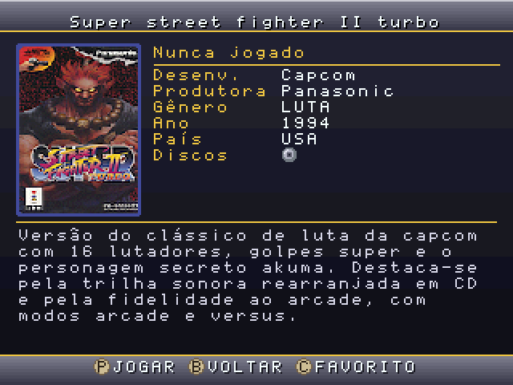</td>
</tr>
<tr>
<td align="center"><b>Lista</b><br>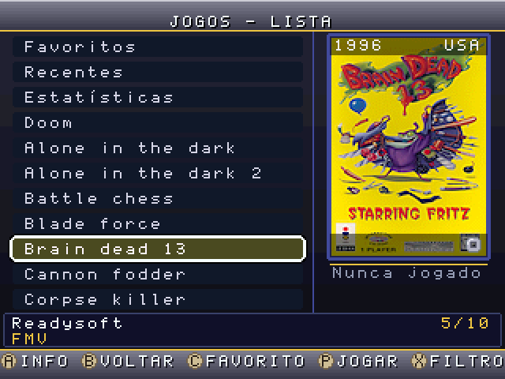</td>
<td align="center"><b>Capas</b><br>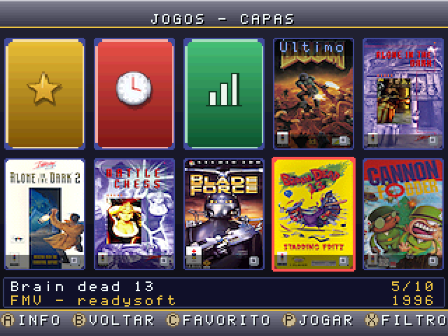</td>
</tr>
<tr>
<td align="center"><b>Carrossel</b><br>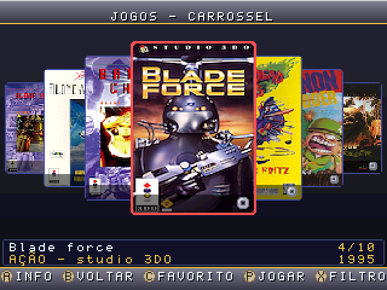</td>
<td align="center"><b>Carrossel FX</b><br>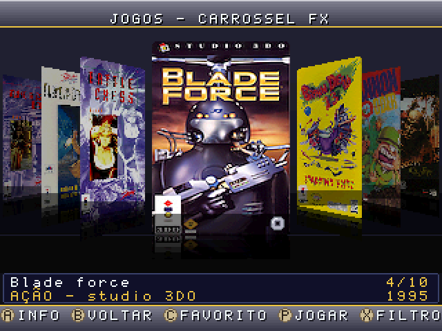</td>
</tr>
<tr>
<td align="center"><b>Vitrine</b><br>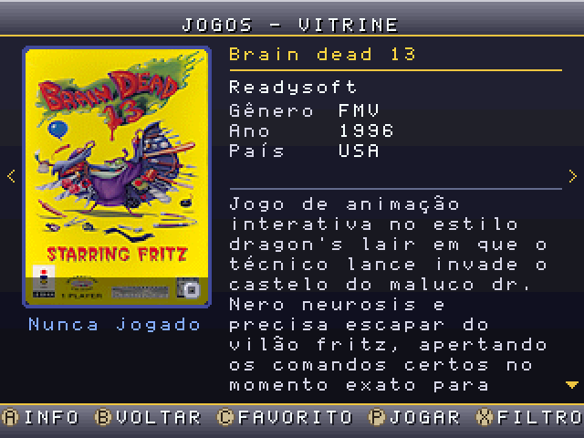</td>
<td align="center"><b>Faixa</b><br>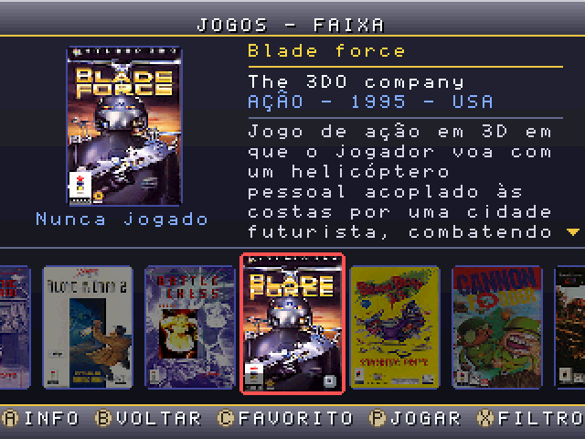</td>
</tr>
<tr>
<td align="center"><b>Opções</b><br>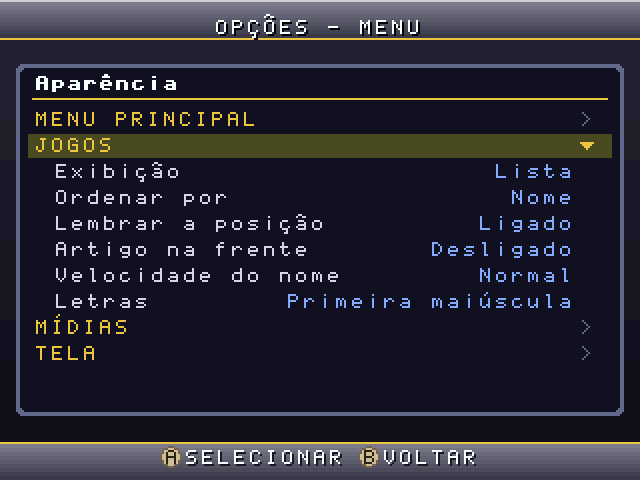</td>
<td align="center"><b>Filtro</b><br>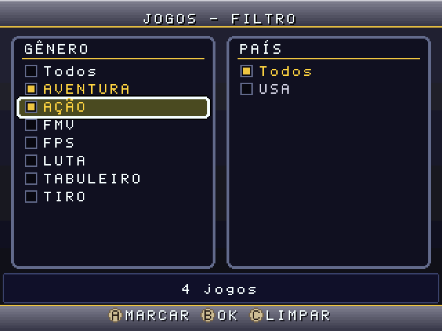</td>
</tr>
<tr>
<td align="center"><b>Estatísticas</b><br>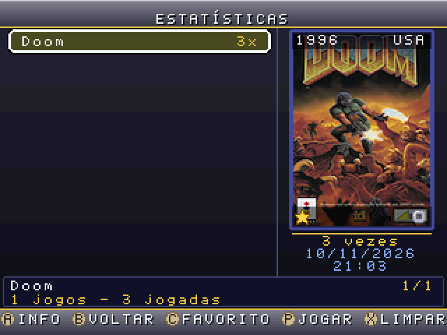</td>
<td align="center"><b>Informações do console</b><br>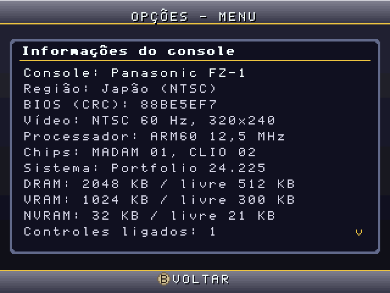</td>
</tr>
</table>

---

## 🎨 Do seu jeito

O menu é **totalmente customizável**. Cada pessoa deixa o 3DO com a cara que quiser, e tudo é gravado sozinho no USB.

| O que você escolhe | Opções |
|---|---|
| **Como ver os jogos** | 6 modos: Lista, Capas, Carrossel, Carrossel FX, Vitrine, Faixa. |
| **O fundo das telas** | 9 fundos: Padrão, Fibra de carbono, Aço escovado, Colmeia, Listras, Grade, Chapa, Vinheta, Pontos. |
| **O que aparece no menu principal** | Favoritos, Recentes, Estatísticas e Último jogo: no menu, dentro de Jogos, nos dois ou em nenhum. |
| **As informações na tela** | Hora, data, temperatura, espaço do USB e espaço da NVRAM: cada uma pode ser mostrada ou escondida. |
| **Onde o console liga** | Menu principal, Jogos, Favoritos ou Recentes. |
| **A ordem da lista** | Nome, ano, gênero, produtora ou mais jogados; com ou sem o artigo na frente; lembrando ou não a última posição. |
| **O que aparece ao lado da lista** | Nada, a capa, a tela ou o vídeo do jogo. |
| **O que a descrição mostra** | 10 combinações de capa, tela e vídeo. |
| **Os textos** | MAIÚSCULAS, minúsculas ou Primeira maiúscula; 5 velocidades para os nomes longos; 3 idiomas. |
| **O som** | Efeitos ligados ou não, 10 músicas ou uma sorteada, volume em barra. |
| **O descanso** | Protetor de tela em 1, 3, 5 ou 10 minutos, ou desligado. |
| **O relógio** | 12 ou 24 horas. |

E para não perder nada: **backup e restauração** das configurações, dos favoritos, dos recentes e das estatísticas, e um botão para **voltar tudo ao padrão**.

---

## ⏰ Relógio de tempo real (RTC)

🟣 **TADEU** 1.0.5 ou mais novo, com o módulo DS3231.

O 3DO nunca teve relógio. Com o firmware **TADEU 1.0.5** e um módulo **DS3231** ligado ao Pico do ODE, ele passa a ter:

- **Data, hora e temperatura** no menu principal (cada uma pode ser escondida nas Opções).
- **"Jogado: dd/mm/aaaa - hh:mm"** no painel do último jogo, nos Recentes e nas Estatísticas.
- **Arquivos com a data certa** no USB: os backups da NVRAM já saem com a data e a hora no nome.
- **Acerto pelo próprio console** em *Opções → Dispositivo ODE → Data e hora*, em 12 ou 24 horas.
- **Aviso de pilha fraca**: se o relógio perdeu a hora, o menu avisa ao ligar e oferece acertar.
- **Formato por idioma**: dia/mês/ano e °C em português e espanhol; mês/dia/ano e °F em inglês.

São **4 fios** no Pico. O passo a passo, com o desenho dos pinos, está em **[docs/RTC.pt.md](docs/RTC.pt.md)**.

<p align="center"></p>

### Detecção automática do relógio

Ao ligar, o menu pergunta ao ODE se existe um relógio e se ele está com a hora certa.

- **Com o módulo instalado**: a data, a hora e a temperatura aparecem, e as opções do relógio entram no menu.
- **Sem o módulo** (ou no firmware de fábrica): **nada aparece e nada muda**. Não há relógio zerado, mensagem de erro nem opção morta: o menu fica exatamente como sempre foi.
- **Com o módulo e a pilha fraca**: o menu avisa uma vez, ao ligar, e oferece acertar a hora.

Para conferir: *Opções → Dispositivo ODE → Recursos* mostra **Relógio (DS3231): Sim** ou **Não**.

---

## 🕹️ Detecção automática do console

Ao ligar, o menu lê um trecho de 256 bytes da BIOS, calcula a assinatura e descobre em qual aparelho está rodando. É instantâneo (ler a BIOS inteira levaria uns 8 segundos).

| Console | Regiões reconhecidas |
|---|---|
| **Panasonic FZ-1** | EUA, Japão, Europa (PAL), unidades de desenvolvimento |
| **Panasonic FZ-10** | EUA, Japão, Europa (PAL) |
| **GoldStar** | EUA |
| **Sanyo TRY** | Japão |

Com isso o menu:

- mostra a **foto do seu console** no topo do menu principal e na tela de sucesso da atualização do firmware;
- informa console, região, assinatura da BIOS, sistema de vídeo, chips, memória livre, controles ligados e módulo FMV em *Opções → Console 3DO → Informações do console*;
- só mostra a extração da **ROM do FMV** se o módulo existe.

**NTSC ou PAL** é perguntado ao sistema, e a tela se ajusta sozinha. Uma revisão de BIOS que ainda não está na tabela aparece como "Desconhecido" e o menu funciona normalmente, só sem a foto.

---

## 🔌 Os dois firmwares

A ODE SataTo3DO tem um firmware na placa RP2040. Existem dois:

- **De fábrica** — o que já vem na placa.
- **TADEU (o nosso)** — opcional. Deixa tudo **muito mais rápido** e liga os recursos novos.

O **menu roda nos dois**: ao ligar, ele pergunta ao ODE qual firmware e qual versão está ali, e só mostra o que aquele firmware sabe fazer. Nada trava por falta de recurso.

| Recurso | De fábrica | TADEU |
|---|:---:|:---:|
| Menu completo, 6 exibições, vídeo, favoritos, estatísticas, saves | ✅ | ✅ |
| Lista de jogos rápida (jogo do fim do USB abre em 2–4 s em vez de ~30 s) | — | ✅ |
| Criar pastas no USB pelo console | — | ✅ |
| Espaço livre do USB no menu | — | ✅ (1.0.4+) |
| Backup do firmware pelo console | — | ✅ |
| Atualização do firmware pelo menu | — | ✅ |
| Relógio, data, hora e temperatura (com o DS3231) | — | ✅ (1.0.5) |
| Arquivos gravados com data e hora | — | ✅ (1.0.5) |

Confira o que o seu ODE tem em *Opções → Dispositivo ODE → Recursos*. Tudo o que depende do TADEU está marcado com o selo 🟣 neste documento.

<table>
<tr>
<td align="center"><b>Informações do ODE — TADEU</b><br>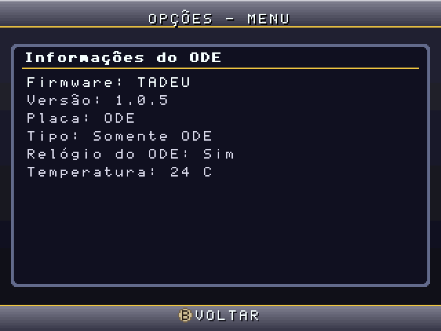</td>
<td align="center"><b>Informações do ODE — de fábrica</b><br>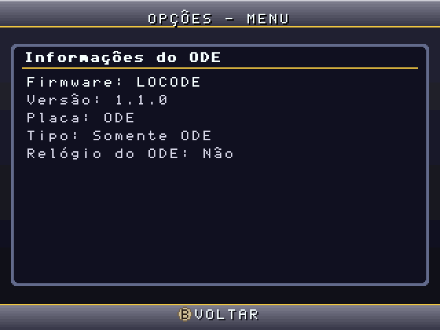</td>
</tr>
</table>

### 🟣 O que o TADEU muda por dentro

- **Lista por extensão**: os jogos são reconhecidos por `.cue` e `.iso` sem abrir cada arquivo. A conferência de verdade fica para a hora de jogar.
- **Paginação incremental**: avançar na lista continua de onde parou, em vez de recomeçar a pasta a cada página.
- **Criação de pastas** (`.config/`, `saves/`, `roms/`, `firmware/`).
- **Backup do firmware**: copia a flash do Pico para o USB, conferido byte a byte.
- **Atualização à prova de erro**: o firmware novo vai para uma área de espera, é conferido por CRC e só então aplicado. Se algo der errado, o firmware atual continua lá.
- **Sempre recuperável**: segure o BOOTSEL, ligue o Pico no PC e arraste um `.uf2`.
- **Número de série do chip**: o firmware sabe informar o identificador único do Pico.
- **Espaço do USB** (tamanho e livre).
- **Relógio DS3231**: data, hora, temperatura e estado da pilha.
- **Um código-fonte para as duas placas**: a original (RP2040-Plus, 4 MB) e a clone com Pico comum (2 MB).

### Somente ODE ou ODE + CD-ROM

O menu detecta sozinho quantas unidades existem e mostra em *Informações do ODE* como **"Somente ODE"** ou **"ODE + CD-ROM"**. Na hora de instalar o firmware, use o `.uf2` da **sua placa**: gravar o da outra deixa a tela preta depois do logo (basta regravar o certo pelo BOOTSEL). A partir do 1.0.6 os arquivos se chamam **DIR-LOW** (placa original Waveshare, chip 74HC245) e **DIR-HIGH** (placas clone como tzmwx e TaiHu, chip 74LVC4245).

### Placa de expansão (Xport)

O **mesmo `boot.iso`** funciona no ODE da porta de expansão. O menu reconhece a placa e aplica o ajuste de memória de que ela precisa.

**USB ou SD, sozinho:** a placa aceita pendrive e cartão microSD. O menu descobre qual dos dois está em uso e troca os textos do sistema inteiro: "Lendo o USB" vira "Lendo o SD", "Informações do USB" vira "Informações do SD", e assim por diante.

### 💿 CD de verdade no Xport, sem tirar a placa

> **O grande destaque desta versão.** O Xport fica na porta de expansão e o leitor de CD do console continua lá, mas o console sempre liga pelo Xport. Até agora, para jogar um disco original era preciso desligar tudo e tirar a placa: o menu de fábrica do Xport não tem essa função. **Este menu tem.**

<p align="center">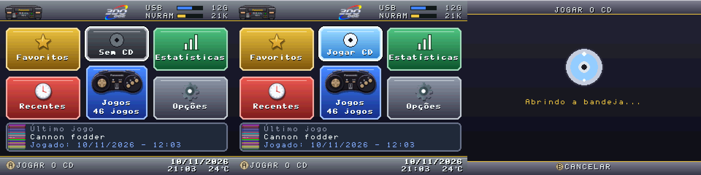</p>

Como funciona:

1. Com o Xport ligado, a tela principal ganha a caixa **CD**, em cima de **Jogos**. Ela fica **cinza escura** quando não há disco no leitor e **azul clara** quando há. (No ODE interno a caixa não aparece: ali o leitor de CD não existe.)
2. Escolha a caixa e aperte **A**. O menu guarda as suas listas, para a música e tira o Xport da porta.
3. **Panasonic FZ-10 (tampa):** a tela pede **"Abra a tampa do CD"** e depois **"Feche a tampa do CD"**. Dá para aproveitar e trocar o disco.
   **Consoles com bandeja (FZ-1, GoldStar, Sanyo):** o menu manda o leitor abrir e fechar a bandeja sozinho; se o leitor não obedecer, a tela pede para apertar o botão da bandeja.
4. A tela mostra **"Carregando o CD..."** e o console **reinicia sozinho no jogo do disco**.

**B** cancela em qualquer passo. Se o disco não iniciar, o Xport volta para a porta e o menu continua normalmente. Para voltar ao menu depois de jogar o CD, desligue e ligue o console.

> **Situação dos testes:** a troca foi confirmada em console real no **Panasonic FZ-10** (abrir e fechar a tampa leva o console para o disco). A abertura automática da **bandeja** nos outros modelos e esta primeira versão dentro do menu ainda estão em teste: se algo não funcionar no seu aparelho, [avise](../../issues).

### Descrição do jogo: você escolhe o que aparece

O **nome do jogo fica na faixa de cima** (se for maior que a faixa, rola devagar). Embaixo vem a **ficha do jogo**: "Jogado: 2x - Última 10/11/2026", **desenvolvedora**, **produtora**, gênero, ano, país e discos (um ícone por disco). Em *Opções > Aparência > Descrição* cada um desses dados pode ser **mostrado ou escondido**. Texto maior que o espaço **rola sozinho**, e rolar a descrição não para o vídeo.

A arrumação da tela acompanha as imagens escolhidas em *Mídias > Descrição*: com **uma imagem**, ela fica à esquerda e a ficha à direita; com **duas**, as duas ficam à esquerda e a ficha e o texto à direita; com **três** (capa, tela e vídeo), as imagens ficam em cima.

<p align="center">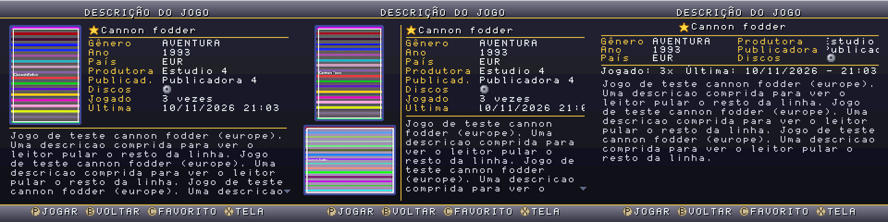</p>

---

## 📺 O menu

### Menu principal

Cinco caixas: **Favoritos**, **Jogos**, **Estatísticas**, **Recentes** e **Opções**, e embaixo o painel do **Último jogo**, com a capa, o nome e quando foi jogado.

- No topo: a foto do console e a barra de espaço da **NVRAM** (os saves do console).
- 🟣 **TADEU** Ao lado, a barra de **espaço do USB ou SD**, com o tamanho e o espaço livre.
- 🟣 **TADEU** Embaixo: **data, hora e temperatura** (com o relógio instalado).
- No painel do último jogo: **A** abre a descrição, **P** joga direto.
- Favoritos, Recentes, Estatísticas e Último jogo podem aparecer no menu, dentro de Jogos, nos dois ou em nenhum.
- Dá para escolher em qual tela o console liga: Menu principal, Jogos, Favoritos ou Recentes.

### 🖼️ Os 6 modos de exibição

Escolha em *Opções → Aparência → Jogos → Exibição*.

| Modo | Como é |
|---|---|
| **Lista** | Nomes à esquerda; à direita a capa, a tela ou o **vídeo** do jogo, com ano, país, discos e favorito. |
| **Capas** | Grade de capas, a selecionada com borda vermelha. |
| **Carrossel** | Capa grande no centro e as vizinhas menores dos lados. |
| **Carrossel FX** | O carrossel em perspectiva, com reflexo no chão e animação. |
| **Vitrine** | Capa grande à esquerda e, ao lado, publicadora, produtora, gênero, ano, país e a **descrição** inteira. |
| **Faixa** | A **tela do jogo** e a descrição em cima; embaixo, uma fileira de capas que desliza. |

Em todos: faixa translúcida na capa com um ícone por disco e a estrela do favorito, e um CD no lugar da capa que faltar.

### Botões

| Onde | Botões |
|---|---|
| **Menu principal** | Direcional escolhe · **A** abre · **P** joga o último jogo |
| **Jogos** | **A** descrição · **B** volta · **C** favorita · **P** joga · **X** filtro · **L / R** pula para a letra anterior / próxima |
| **Vitrine e Faixa** | ◄ ► troca de jogo · ▲ ▼ rola a descrição |
| **Descrição** | **P** joga · **B** volta · **C** favorita · **X** vídeo ou tela em tela cheia · ◄ ► jogo anterior / próximo · ▲ ▼ rola o texto |
| **Favoritos** | **A** descrição · **B** volta · **C** tira dos favoritos · **P** joga |
| **Recentes e Estatísticas** | Iguais a Jogos, com **X** para limpar a lista |
| **Filtro** | **A** marca · **C** limpa · **B** aplica e volta |
| **Opções** | ▲ ▼ anda · ◄ ► ou **A** muda · **B** volta |

Segurar o direcional acelera a rolagem.

### A lista de jogos

- **Lista única ou por pastas**: por padrão, os jogos em subpastas (até 3 níveis) entram numa só lista em ordem alfabética. A opção nova **Mostrar jogos: Pastas** deixa navegar pelas pastas do cartão (entra com **A**, volta com **B**); pasta com um jogo só vira o próprio jogo.
- **Ordenação**: por nome, ano, gênero, produtora ou mais jogados. O **L / R** pula de grupo em grupo (letra, ano, gênero…).
- **Artigo na frente**: mostra "The Need for Speed" em vez de "Need for Speed, The".
- **Multi-disco**: os discos de um jogo viram uma entrada só. Ao jogar, todos entram na fila do ODE.
- **Lembrar a posição**: ao abrir Jogos, a seleção volta para o último jogo jogado.
- **Lista guardada**: o menu pode guardar a lista de jogos e ligar bem mais rápido (*Ler ao ligar*: Sim, Só se houver novos, Não).
- **Nome longo** rola sozinho, em 5 velocidades.
- **Formatos de jogo**: `.iso` e `.cue` + `.bin`. O gerador converte `.chd` no PC.

### Descrição do jogo

Capa, tela e vídeo do jogo (você escolhe a combinação entre 10), gênero, ano, país, produtora e a descrição completa. O **X** abre o vídeo ou a tela em tela cheia.

### Jogo iniciando

Ao apertar **P** aparece o cartão do jogo: capa, nome, gênero, ano e país, quantas vezes foi jogado e, em jogos de vários discos, "N discos adicionados na fila".

### ⭐ Favoritos, 🕑 Recentes e 📊 Estatísticas

- **Favoritos**: **C** marca e desmarca, com animação e som da estrela.
- **Recentes**: os últimos jogos. 🟣 **TADEU** Com o relógio, também a data e a hora de cada um.
- **Estatísticas**: ranking dos mais jogados, com o total de jogos e de partidas.
- Tudo fica guardado no USB, em `.config/`, e entra no backup das configurações.

### 🔎 Filtro

**X** na lista de jogos abre duas colunas, **Gênero** e **País**. Marque quantos quiser em cada uma; embaixo aparece quantos jogos passam no filtro.

---

## ⚙ Opções — o menu inteiro

Clique em cada seção para abrir. Tudo é gravado sozinho no USB (`.config/3doconfig.ode`).

<details>
<summary><b>🎨 Aparência</b></summary>

No console, esta seção é uma sanfona: abra um grupo por vez.

<details>
<summary>Menu principal</summary>

| Opção | Valores | O que faz |
|---|---|---|
| Favoritos | Menu e Jogos · Menu Principal · Jogos · Desligado | Onde a entrada dos Favoritos aparece. |
| Recentes | idem | Onde os Recentes aparecem. |
| Estatísticas | idem | Onde as Estatísticas aparecem. |
| Último jogado | idem | Painel do último jogo no menu e entrada "Último" no topo de Jogos. |
| Hora | Mostrar · Esconder | 🟣 **TADEU** Só aparece com o relógio. |
| Data | Mostrar · Esconder | 🟣 **TADEU** Só aparece com o relógio. |
| Temperatura | Mostrar · Esconder | 🟣 **TADEU** Só aparece com o relógio. |
| Espaço do USB | Mostrar · Esconder | 🟣 **TADEU** 1.0.4 ou mais novo. |
| Espaço da NVRAM | Mostrar · Esconder | Memória de saves do console. |
| Tela ao ligar | Menu principal · Jogos · Favoritos · Recentes | Onde o console começa. |

</details>

<details>
<summary>Jogos</summary>

| Opção | Valores | O que faz |
|---|---|---|
| Exibição | Lista · Capas · Carrossel · Carrossel FX · Vitrine · Faixa | O modo de ver os jogos. |
| Ordenar por | Nome · Ano · Gênero · Produtora · Mais jogados | A ordem da lista. |
| Lembrar a posição | Ligado · Desligado | Abre Jogos no último jogo jogado. |
| Artigo na frente | Ligado · Desligado | "The Need for Speed" em vez de "Need for Speed, The". |
| Velocidade do nome | Muito lenta · Lenta · Normal · Rápida · Muito rápida | Rolagem dos nomes longos. |
| Letras | MAIÚSCULAS · minúsculas · Primeira maiúscula | Como os textos são escritos. |

</details>

<details>
<summary>Mídias</summary>

| Opção | Valores | O que faz |
|---|---|---|
| Lista | Desligado · Capa · Tela · Vídeo | O que aparece ao lado da lista (só no modo Lista). |
| Descrição | Desligado · Capa · Capa + Tela · Capa + Tela + Vídeo · Capa + Tela / Vídeo · Capa + Vídeo · Tela · Tela + Vídeo · Tela / Vídeo · Vídeo | O que a tela de descrição mostra. |
| Formato das capas | Original · Ambilight · Fundo preto · Esticada | Como aparece a capa que não tem a proporção da caixa (long box, caixa de CD). Veja [Formato das capas](#formato-das-capas). |

</details>

<details>
<summary>Tela</summary>

| Opção | Valores | O que faz |
|---|---|---|
| Tema | 3DO | O tema de cores. |
| Fundo | Padrão · Fibra de carbono · Aço escovado · Colmeia · Listras · Grade · Chapa · Vinheta · Pontos | O fundo de todas as telas. |
| Protetor de tela | Desligado · 1 · 3 · 5 · 10 minutos | O logo do 3DO e os consoles passeando pela tela. |

</details>

</details>

<details>
<summary><b>🎵 Áudio</b></summary>

| Opção | Valores | O que faz |
|---|---|---|
| Efeitos sonoros | Ligado · Desligado | Sons de andar, voltar, favoritar. |
| Música de fundo | Desligada · Órbita · Pixel Rush · Neon Drive · Nebulosa · Arcade · Deserto · Templo · Horizonte · Caravana · Aurora · Aleatória | 10 faixas, ou uma sorteada a cada vez que liga. |
| Volume da música | Barra de 0 a 10 | Muda na hora, com a música tocando. |

</details>

<details>
<summary><b>💾 Armazenamento e Saves</b></summary>

| Item | O que faz |
|---|---|
| **Gerenciador de armazenamento** | Duas abas, **Console (NVRAM)** e **USB (saves/)**. Copia um save ou todos de um lado para o outro e apaga saves do console. **L / R** troca de aba. |
| **Fazer backup da NVRAM** | Copia a memória de saves inteira (32 KB) para `saves/`. 🟣 **TADEU** Com o relógio, o arquivo leva a data e a hora no nome. |
| **Restaurar backup da NVRAM** | Devolve o último backup para o console. |
| **Diagnóstico da NVRAM** | Espaço usado, saves e se a memória está formatada. |

</details>

<details>
<summary><b>🔌 Dispositivo ODE</b></summary>

| Item | O que faz |
|---|---|
| **Informações do ODE** | Firmware, versão, placa, tipo (Somente ODE ou ODE + CD-ROM), relógio e temperatura. |
| **Recursos** | Diz "Sim" ou "Não" para cada recurso do seu ODE: relógio, temperatura, espaço do USB, lista rápida, backup e atualização. |
| **Informações do USB** | Jogos, discos, capas na memória e velocidade de leitura. 🟣 **TADEU** Também o tamanho e o espaço livre. |
| **Ler o USB de novo** | Relê a lista de jogos. |
| **Ler ao ligar** | Sim · Só se houver novos · Não. Com a lista guardada o console liga mais rápido. |
| **Backup do firmware** 🟣 **TADEU** | Copia o firmware do ODE para `firmware/` no USB. |
| **Atualizar firmware** 🟣 **TADEU** | Grava `firmware/update.ode` (ou `.uf2`, ou `.3do`), mostra o arquivo, o percentual e a velocidade; **B** cancela antes de aplicar. No fim o ODE reinicia; se o menu não voltar, desligue e ligue o console. |
| **Data e hora** 🟣 **TADEU** | Só aparece com o relógio. Acerta a data e a hora e escolhe 12 ou 24 horas. |
| **Testar o ODE e o USB** | Diagnóstico com tempos de leitura e de capas; grava um relatório no USB. |

</details>

<details>
<summary><b>🕹️ Console 3DO</b></summary>

| Item | O que faz |
|---|---|
| **Informações do console** | Console, região, assinatura da BIOS, vídeo, processador, chips, sistema, DRAM, VRAM, NVRAM, controles ligados, módulo FMV, música e capas na memória. |
| **Ajuste de imagem** | Padrão de teste com grade, barras de cor e a borda da área visível. |
| **Teste de controle** | Foto do controle; cada botão acende na cor de quem apertou. **Até 8 controles**, cada um com a sua cor. Segure A + B + C por 5 s para sair. |
| **ROM do sistema** | Grava a BIOS do console em `roms/`. |
| **ROM da fonte** | Grava a ROM de fontes em `roms/`. |
| **ROM do FMV** | Só aparece se o módulo FMV está ligado. |
| **Memória RAM** | Grava a RAM em `roms/`. |

As gravações mostram o percentual na barra e, no fim, o tamanho e o tempo gasto.

</details>

<details>
<summary><b>🌐 Geral</b></summary>

| Item | O que faz |
|---|---|
| **Idioma** | Português · Español · English. Troca na hora. |
| **Sobre** | Versão do menu, firmware e versão do ODE e os agradecimentos. |
| **Fazer backup das configurações** | Guarda no USB uma cópia das configurações, dos recentes, dos favoritos e das estatísticas. |
| **Restaurar o backup** | Traz de volta a cópia guardada. |
| **Restaurar os padrões** | Volta as opções ao padrão. Favoritos, recentes e estatísticas não mudam. |

</details>

---

## 🎬 Mídias: capas, telas e vídeo

Tudo é preparado no PC pelo `generate_usb.py` e fica **na raiz do USB**, com o mesmo nome do arquivo do jogo.

| Pasta | Formato | Tamanho | Onde aparece |
|---|---|---|---|
| `covers/small/` | CEL 16 bits | até 56 × 78 | Grade de Capas e painel do último jogo |
| `covers/large/` | CEL 16 bits | até 100 × 140 | Lista, carrosséis, Vitrine, Faixa e descrição |
| `screenshots/medium/` | CEL 16 bits | até 120 × 90 | Lista, Faixa e descrição |
| `screenshots/large/` | CEL 16 bits | até 304 × 228 | Tela cheia (X na descrição) |
| `videos/` | **Cinepak** (`.cvd`) | 80 × 60 até 320 × 240 | Lista, descrição e tela cheia |

### Formato das capas

As capas são gravadas **na proporção da própria capa**: uma long box fica perto de 76 × 140, uma caixa de CD perto de 100 × 87, e a capa comum ocupa os 100 × 140 inteiros. Em *Opções → Aparência → Mídias → Formato das capas* você escolhe como o menu mostra as que não ocupam a caixa toda:

| Formato | Como fica |
|---|---|
| **Original** (padrão) | A capa na proporção dela, com a moldura em volta. |
| **Ambilight** | A capa no meio e um brilho nas cores da própria capa preenchendo a sobra. |
| **Fundo preto** | A capa no meio e a sobra preta. |
| **Esticada** | A capa esticada para a caixa inteira, como era até a 1.3. |

<p align="center">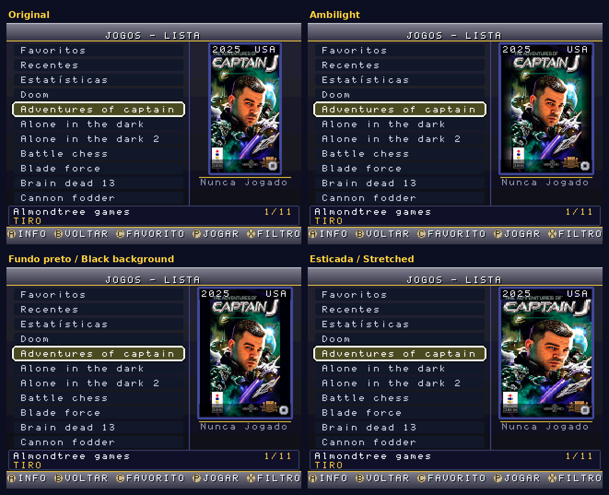</p>

Vale em todas as telas (Lista, Capas, carrosséis, Vitrine, Faixa, descrição e a capinha do menu principal). Na Lista, a capa sempre começa na altura da primeira linha de jogos. As imagens são reduzidas pela média de toda a área da imagem original, com nitidez leve e sem pontilhado.

### Vídeo em Cinepak

A prévia em vídeo usa **Cinepak**, o mesmo codec dos jogos de 3DO, com um decodificador próprio dentro do menu.

- **Tamanhos**: `mini` 80 × 60 · `box` 128 × 96 · `small` 160 × 120 (padrão) · `medium` 240 × 180 · `large` 320 × 240.
- **Padrão**: 15 quadros por segundo, 20 segundos, qualidade 4 (de 1 a 31; menor é melhor e maior).
- **Já prontos**: os vídeos deste repositório já estão convertidos nesse padrão; o gerador só copia. Quem converter os próprios vídeos escolhe o tamanho, os quadros por segundo e a duração.
- **Sem som**, lido do começo ao fim direto do USB.
- A conversão é feita pelo gerador com o **ffmpeg**, um vídeo por núcleo do PC ao mesmo tempo.
- O vídeo toca na caixa da lista, na descrição e em tela cheia. Qualquer botão para.

### Textos dos jogos

`.config/3dogamesdetails.ode` traz ano, gênero, produtora, publicadora e descrição de cada jogo. Ano, gênero e produtora são lidos uma vez ao ligar; a descrição é lida na hora em que aparece.

---

## 🛠️ Preparar o USB / SD

### Pelo navegador

Abra **[https://cyberrep.github.io/3doode/](https://cyberrep.github.io/3doode/)**, escolha o seu USB / SD e a página copia o menu, as capas, as telas, os vídeos e os textos dos seus jogos, já prontos. Funciona no Chrome e no Edge do computador. Para converter os jogos (`.chd`, `.iso`) ou usar outro navegador, use o gerador abaixo.

### Pelo gerador


Você baixa **um único arquivo**. Ele faz todo o resto com um assistente passo a passo (a primeira pergunta é o idioma):

- **baixa a arte que faltar** e gera as **capas** e as **telas** nos dois tamanhos;
- converte os **vídeos** para Cinepak;
- gera os **textos dos jogos** (ano, gênero, produtora, descrição);
- converte **`.chd` → `.bin/.cue`** e, se quiser, **`.iso` → `.bin/.cue`**;
- renomeia discos com nome genérico e **organiza** os jogos (na raiz ou em pastas por letra);
- **copia o `boot.iso`** para a raiz do USB;
- cria o arquivo de opções já no seu idioma;
- pode **baixar e preparar o firmware** da sua placa.

Ele **nunca apaga** os seus arquivos.

### Requisitos

- **Python** e, para converter vídeos, o **FFmpeg**. O [manual do gerador](docs/MANUAL.pt.md) traz os comandos prontos para copiar e colar no PowerShell.

### Passo a passo

1. Rode `py generate_usb.py` e siga o assistente.
2. Ponha o USB no ODE e ligue o console.
3. (Opcional) Para instalar o **firmware TADEU** pela primeira vez: segure o BOOTSEL, ligue o Pico no PC e arraste o `.uf2` da sua placa para o disco **RPI-RP2**. Depois disso, as atualizações são pelo menu.
4. (Opcional) Instale o **[relógio DS3231](docs/RTC.pt.md)**.

O manual completo do gerador está em **[docs/MANUAL.pt.md](docs/MANUAL.pt.md)**.

---

## 📂 Como fica o USB / SD

```
boot.iso                 o menu
Jogo (USA).iso           os seus jogos (.iso ou .cue + .bin), na raiz ou em pastas
covers/small/            capas até 56x78
covers/large/            capas até 100x140
screenshots/medium/      telas pequenas
screenshots/large/       telas grandes (tela cheia)
videos/                  prévias em Cinepak (.cvd)
.config/                 opções, favoritos, recentes, estatísticas, textos dos jogos,
                         lista guardada e as cópias de segurança (.bak)
saves/                   saves copiados do console e backups da NVRAM
roms/                    ROMs e RAM extraídas do console
firmware/                backup do firmware e o arquivo de atualização
```

## 📦 O que tem neste repositório

```
boot/        o menu (boot.iso) — sempre a última versão
firmware/    o firmware TADEU (.uf2) para as duas placas
media/       capas, telas e vídeos já convertidos para o cartão, e a base de textos dos jogos
tools/       o gerador (generate_usb.py, um arquivo só)
docs/        o manual do gerador e o manual do relógio
```

---

## 🙏 Créditos

Feito sobre o trabalho de duas pessoas, a quem agradeço:

- **[Fixel](https://github.com/fixelsan/3do-ode-firmware)** — a placa ODE e o driver do ODE.
- **[FCare / SataTo3DO](https://github.com/FCare/SataTo3DO)** — o firmware base, de onde o TADEU nasceu.

🏆 **Um agradecimento especial ao MNEMO**, que criou o **primeiro ODE do 3DO** e abriu o caminho para todos os outros.

Também usamos:

- **[libretro-thumbnails](https://github.com/libretro-thumbnails/The_3DO_Company_-_3DO)** — parte das capas e telas que o gerador baixa.
- **[3do-devkit](https://github.com/trapexit/3do-devkit)**, do trapexit — o kit de desenvolvimento com que o menu é compilado.
- **[FFmpeg](https://ffmpeg.org/)** — a conversão dos vídeos para Cinepak.
- **[Pillow](https://python-pillow.org/)** e **[NumPy](https://numpy.org/)** — as imagens e a conversão de discos no gerador.
- **chdman** (do projeto MAME) — a conversão dos jogos em `.chd`.
- **Wikipedia** — a publicadora de cada jogo.

### 🧪 Testadores

Obrigado a quem testou cada versão no console de verdade:

- **[NandoGames](https://www.youtube.com/@NandoGamesBrasil)**
- **Luiz Ganso**
- **Otávio Augusto**

O menu vem sendo desenvolvido desde **10 de outubro de 2026**. A versão 1.0 foi reescrita do zero em novembro de 2026.

Jogos e BIOS **não** são fornecidos.

## 📝 Histórico

O histórico completo do menu, do firmware e do gerador está em **[CHANGELOG.pt.md](CHANGELOG.pt.md)**.

---

## 💛 Sobre o projeto

**Feito com amor** por um dos maiores colecionadores de 3DO do Brasil — anos mergulhado no console, estudando e testando cada detalhe (com uma mãozinha do Claude pelo caminho).

🔧 Também estou trabalhando para rodar no **ODE do MNEMO**.

☕ **Curtiu o projeto? Você pode apoiar com uma doação:**

- PayPal: `compras@rodrigotadeu.com.br`
- Pix (chave aleatória): `7337eb1c-74f0-4d14-97bb-b49ff0265869`

## ⚖️ Licença

**Uso pessoal e gratuito.** Não é permitido modificar, descompilar, fazer engenharia reversa, vender (nem entregar junto com um produto vendido) ou usar este projeto para treinar inteligência artificial. O texto completo está em **[LICENSE.md](LICENSE.md)**; as partes feitas por outras pessoas e as licenças delas estão em **[THIRD-PARTY.md](THIRD-PARTY.md)**.

As mídias (capas, telas, vídeos) vêm de acervos públicos e são para uso pessoal.
