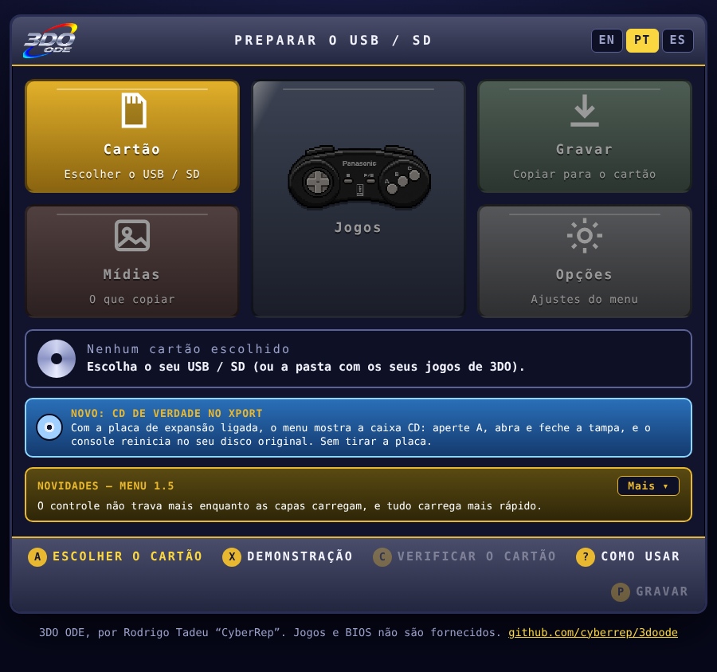
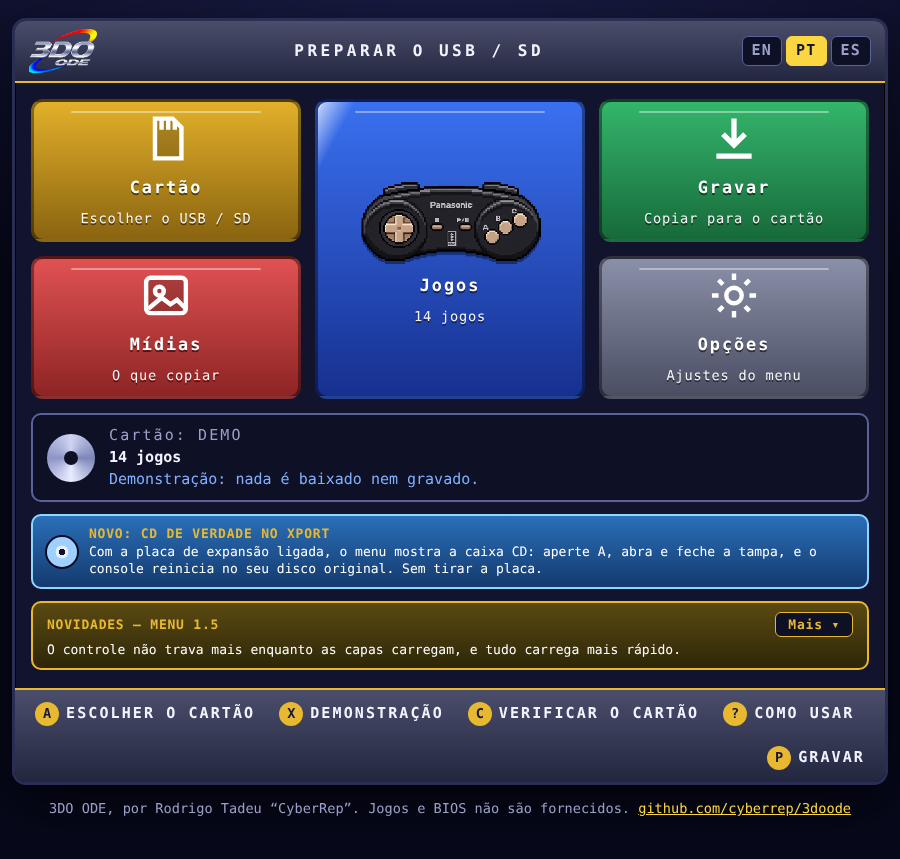
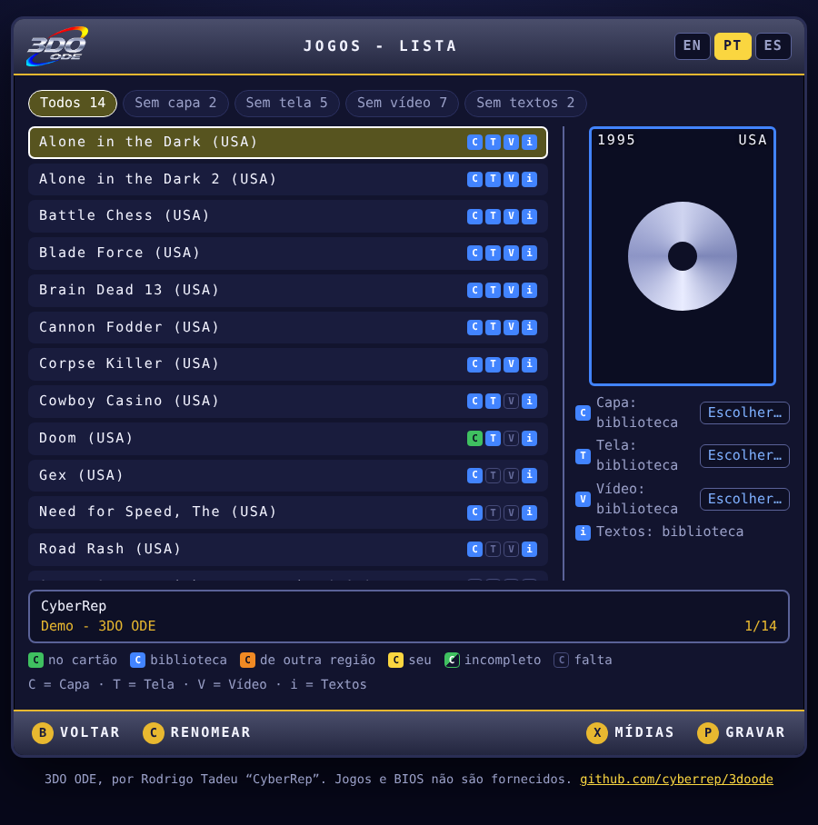
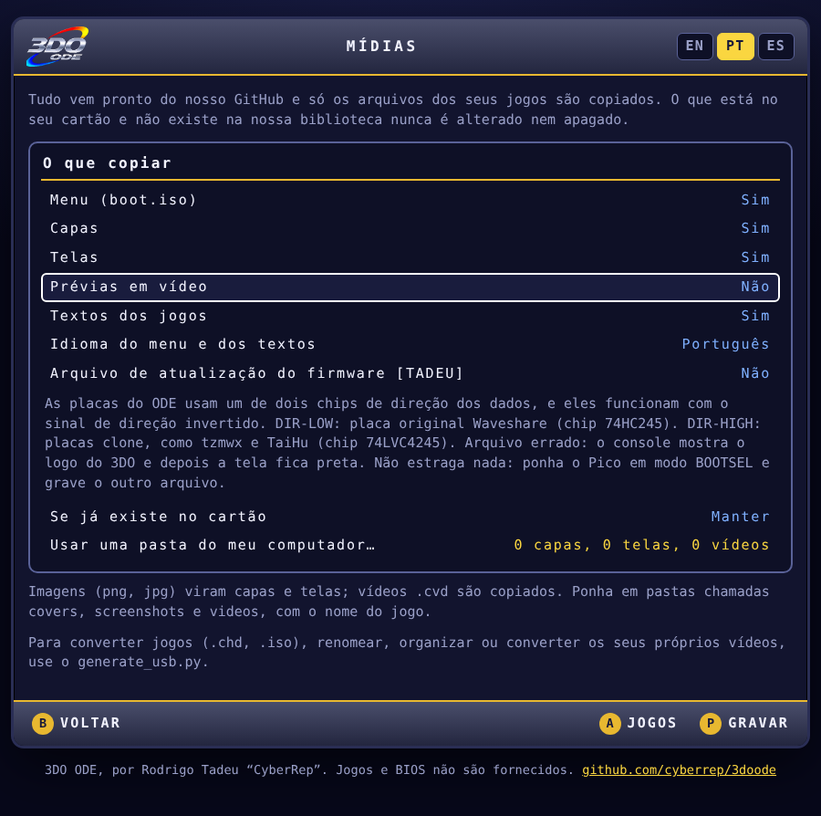
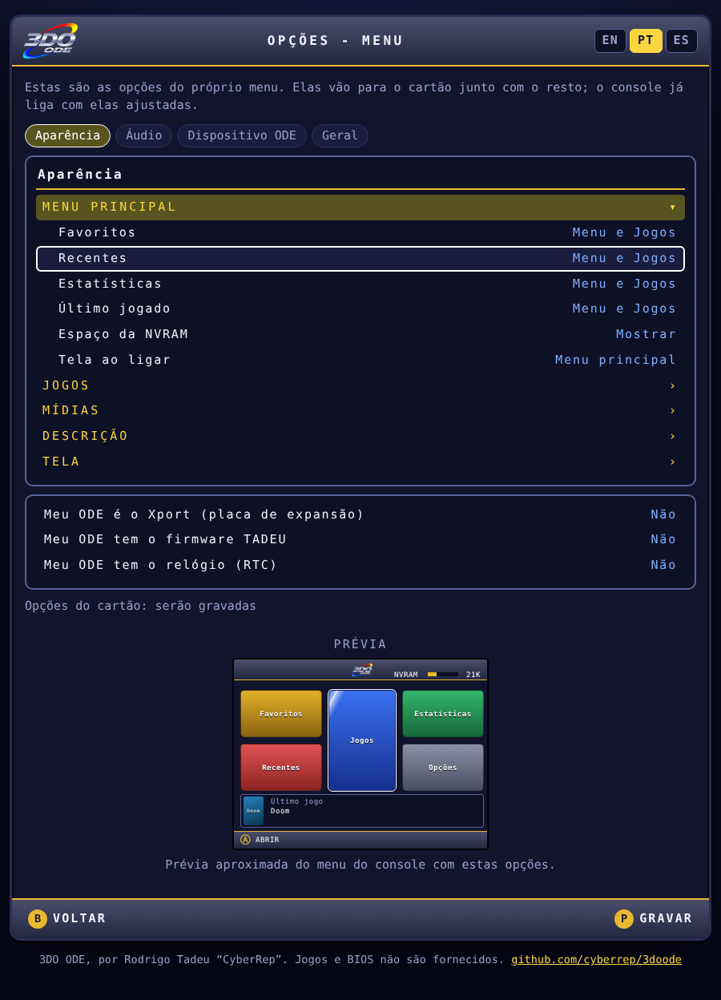
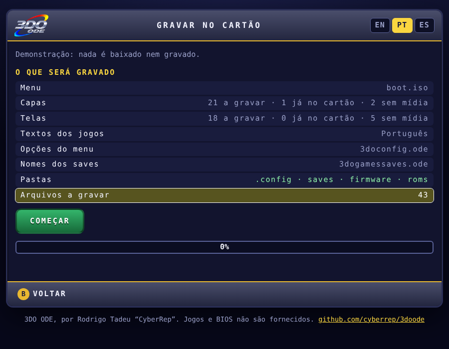
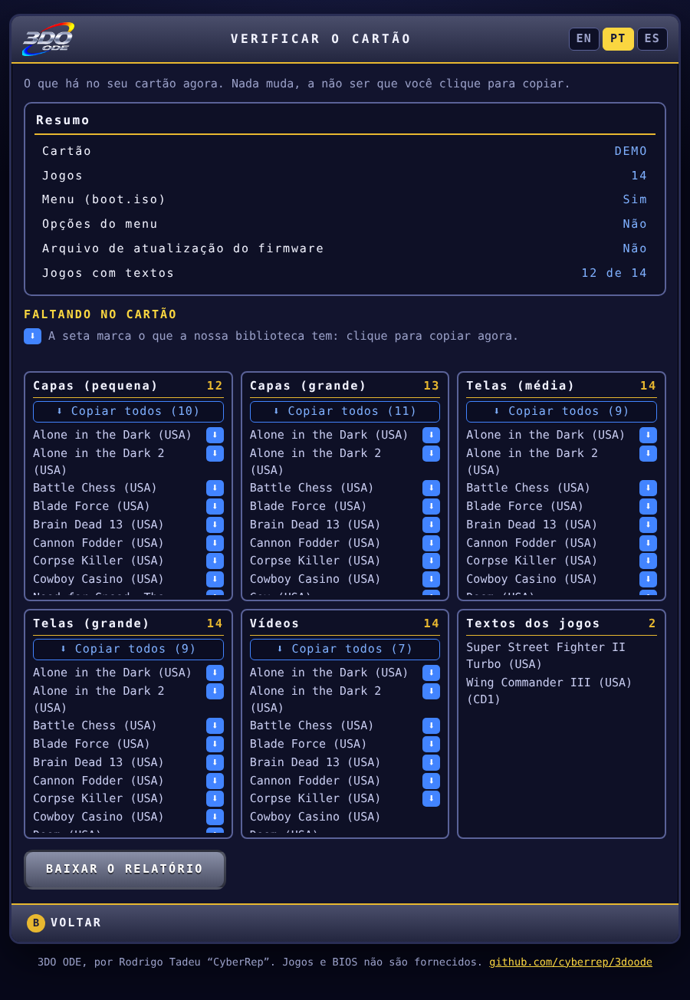

# 🌐 Preparar el USB / SD desde el navegador — Manual

[← Volver al inicio](../README.es.md) · [English](SITE.md) · [Português](SITE.pt.md) · **Español**

**Esta es la forma recomendada.** Abres una página, eliges tu tarjeta y ella copia el menú, las portadas, las capturas, los vídeos y los textos de tus juegos, ya listos. No se instala nada.

👉 **[https://cyberrep.github.io/3doode/](https://cyberrep.github.io/3doode/)**

> ¿Necesitas convertir juegos (`.chd`, `.iso`), usar Firefox o Safari, o convertir tus propios vídeos? Eso es cosa del [generador en Python](MANUAL.es.md).

*(Las capturas de abajo muestran la página en portugués; los botones están en el mismo lugar en español.)*

---

## ✅ Lo que necesitas

- Un **ordenador** (Windows, Mac o Linux). Móvil y tableta no sirven.
- **Chrome, Edge, Brave, Opera o Vivaldi**. En Firefox y Safari la página se abre, pero solo muestra la demostración: esos navegadores no dejan grabar en la tarjeta.
- Tu **USB / SD**, con los juegos de 3DO ya dentro (`.iso` o `.cue` + `.bin`).
- Internet. Los medios vienen de nuestra biblioteca en GitHub.

**No se proporcionan juegos ni BIOS.**

---

## 🚀 Paso a paso

La página tiene cinco botones, en el orden en que los usas: **Tarjeta → Juegos → Medios → Opciones → Grabar**.

El botón **Cómo usar** de la propia página muestra un resumen de estos pasos.

### 1. Tarjeta — elegir el USB / SD

1. Haz clic en **Tarjeta** y luego en **Elegir la tarjeta**.
2. En la ventana del navegador, selecciona **la unidad de la tarjeta** (por ejemplo `E:\`) y confirma.
3. El navegador pregunta si la página puede **ver y editar los archivos**. Responde **sí** — sin eso no puede grabar.

La página lee la tarjeta y muestra cuántos juegos encontró y qué le falta a cada uno.

> ¿Solo quieres ver cómo funciona? Haz clic en **Demostración**: no se descarga ni se graba nada.

### 2. Juegos — revisar la lista

Muestra cada juego y lo que tiene: **portada, captura, vídeo y textos**. La leyenda dice de dónde viene cada elemento:

| Leyenda | Significa |
|---|---|
| **en la tarjeta** | ya está grabado |
| **biblioteca** | se copiará de nuestra biblioteca |
| **de otra región** / **de título parecido** | no tenemos la de ese disco exacto; usamos la de otra versión del mismo juego |
| **tuyo** | archivo tuyo (de tu carpeta) |
| **falta** | no lo tenemos y tú tampoco |

Usa los filtros (**Sin portada**, **Sin captura**, **Sin vídeo**, **Sin textos**) para encontrar lo que falta.

**Renombrar.** Los medios se asocian al juego **por el nombre del archivo**. Si muchos juegos aparecen sin nada, haz clic en **Renombrar → Comprobar los nombres**: la página propone el nombre oficial de cada disco y corrige el `.cue` a la vez. No se convierte ni se borra nada.
- **por el contenido**: el disco coincide con la lista oficial, es seguro.
- **por el nombre**: solo coincide el título — revísalo antes de marcar.

> El ODE solo lee nombres de hasta **126 letras** (con la extensión). Por encima de eso los medios no se abren.

### 3. Medios — qué copiar

Marca lo que quieres en la tarjeta:

- **Menú (boot.iso)** — el menú del ODE. Déjalo activado para tener siempre la versión actual.
- **Portadas**, **Capturas**, **Vistas previas en vídeo**, **Textos de los juegos**.
- **Idioma del menú y de los textos** — Português, Español o English.
- **Si ya existe en la tarjeta** — **Mantener** (solo copia lo que falta, más rápido) o **Sustituir** (lo graba todo de nuevo).
- **Archivo de actualización del firmware** — opcional. Márcalo solo si vas a actualizar el firmware; mira el aviso de abajo.

Solo se copian los archivos **de tus juegos**. Lo que está en tu tarjeta y no existe en nuestra biblioteca **nunca se cambia ni se borra**.

**Tus propias imágenes y vídeos.** Haz clic en **Usar una carpeta de mi ordenador…** y elige una carpeta con subcarpetas `covers`, `screenshots` y `videos`. Las imágenes `png`/`jpg` con el nombre del juego se convierten en portadas y capturas; los vídeos `.cvd` se copian.

> ⚠️ **Firmware: ¿DIR-HIGH o DIR-LOW?**
> **DIR-LOW**: placa original Waveshare. **DIR-HIGH**: placas clon (tzmwx, TaiHu).
> ¿Grabaste el equivocado? La consola muestra el logo de 3DO y la pantalla queda en negro. No se estropea nada: pon el Pico en BOOTSEL y graba el otro.

### 4. Opciones — ajustar el menú

Son las opciones del propio menú de la consola (apariencia, modo de visualización, sonido…). Van a la tarjeta y la consola arranca ya con ellas ajustadas. La **Vista previa** muestra, de forma aproximada, cómo quedará el menú.

Marca lo que corresponde a tu placa: **Mi ODE es el Xport**, **Mi ODE tiene el firmware TADEU**, **Mi ODE tiene el reloj (RTC)**.

¿No quieres tocar nada? Salta este paso: las opciones que ya están en la tarjeta quedan como están.

### 5. Grabar

1. Haz clic en **Grabar**. El resumen **"Lo que se grabará"** muestra cuántos archivos van, cuántos ya están en la tarjeta y cuántos juegos quedan sin medios.
2. Haz clic en **Empezar**.
3. **Deja la pestaña abierta hasta que termine.** Puede tardar desde unos minutos hasta bastante más, según la cantidad de juegos y vídeos.
4. Apareció **"Tarjeta lista"**: expulsa la tarjeta de forma segura, ponla en el ODE y enciende la consola.

Al final, **"Lo que faltó"** lista los juegos que quedaron sin algún medio; puedes descargar la lista.

---

## 🔎 Comprobar la tarjeta

En cualquier momento, **Comprobar la tarjeta** muestra lo que hay en ella ahora: juegos, menú, opciones, lo que **falta** y lo que **sobra** (medios sin juego). Nada cambia solo por abrir esa pantalla. Donde aparece la flecha, nuestra biblioteca tiene el archivo: haz clic para copiarlo al momento, o cópialos todos de una vez.

---

## 🔄 Actualizar a una versión nueva del menú

Abre la página, elige la tarjeta, deja **Menú (boot.iso)** activado y **Si ya existe en la tarjeta: Mantener**, y graba. Cambia el menú y copia solo lo que falte.

Cuando una versión cambia el formato de las imágenes (como la 1.4), la página detecta las portadas y capturas antiguas y las cambia sola en la primera grabación.

---

## ❓ Problemas comunes

| Qué pasa | Qué hacer |
|---|---|
| "Este navegador no puede grabar en tu tarjeta." | Usa Chrome, Edge, Brave, Opera o Vivaldi en un ordenador. |
| El navegador no deja elegir la unidad | Elige la unidad de la tarjeta, no una carpeta del sistema (Escritorio, Documentos, Descargas). |
| "Ningún juego (.iso o .cue) en esta carpeta." | Elegiste la carpeta equivocada, o los juegos están en `.chd`: conviértelos con el [generador](MANUAL.es.md). |
| Muchos juegos sin portada | Los nombres no coinciden con la lista oficial: usa **Renombrar**. |
| "No pude leer la biblioteca en GitHub." | Sin internet, o GitHub está caído. Inténtalo de nuevo en unos minutos. |
| La grabación se paró a medias | Haz clic en **Grabar** de nuevo con **Mantener**: sigue desde donde se paró. |
| El menú muestra un nombre corto (tipo `NISHIM~1`) | Nombre de archivo de más de 126 letras: acórtalo. |

---

## 🧰 Lo que la página no hace

- Convertir juegos (`.chd` → `.iso`, `.iso` → `.bin/.cue`).
- Convertir tus vídeos al formato del 3DO.
- Organizar los juegos en carpetas.
- Funcionar en Firefox, Safari o en el móvil.

Para eso existe **[generate_usb.py](MANUAL.es.md)**.
