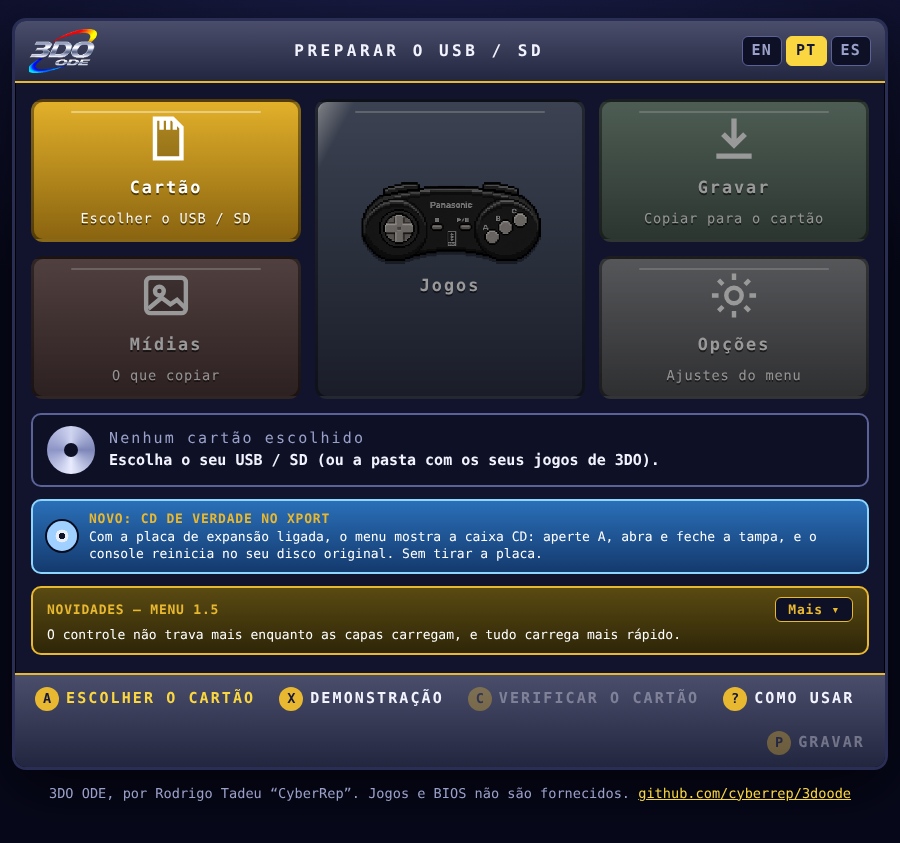
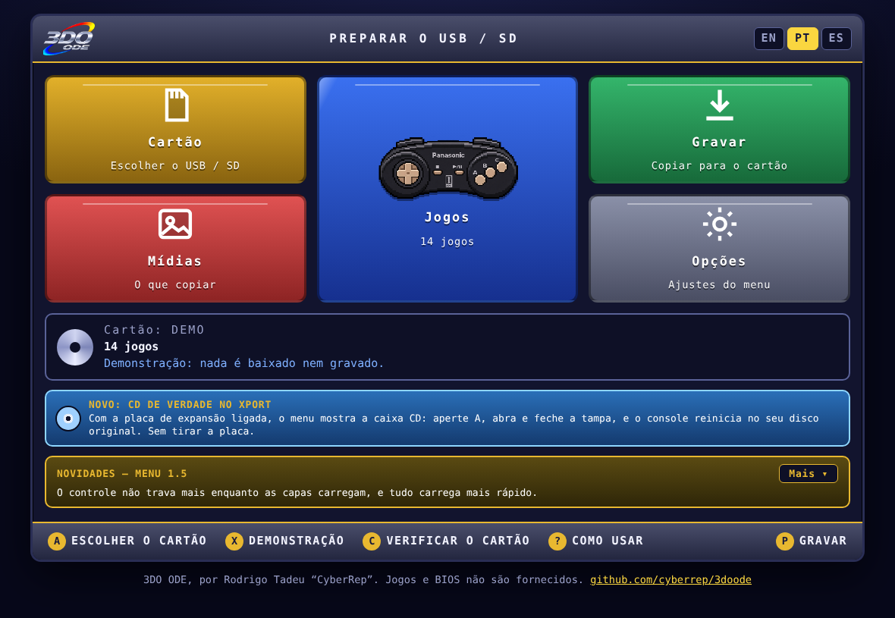
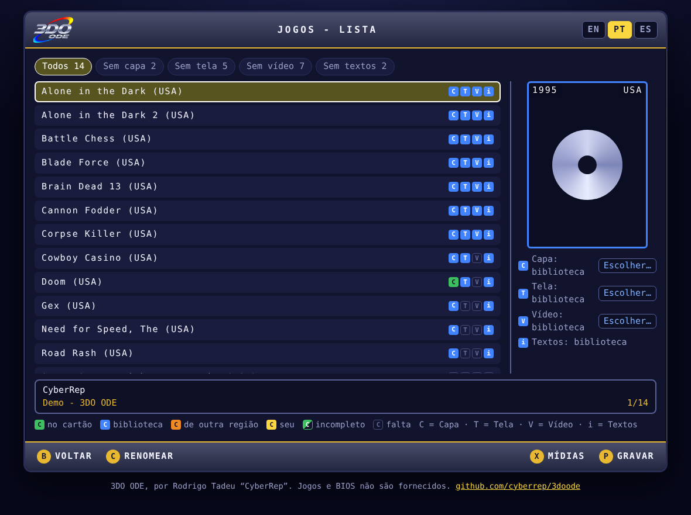
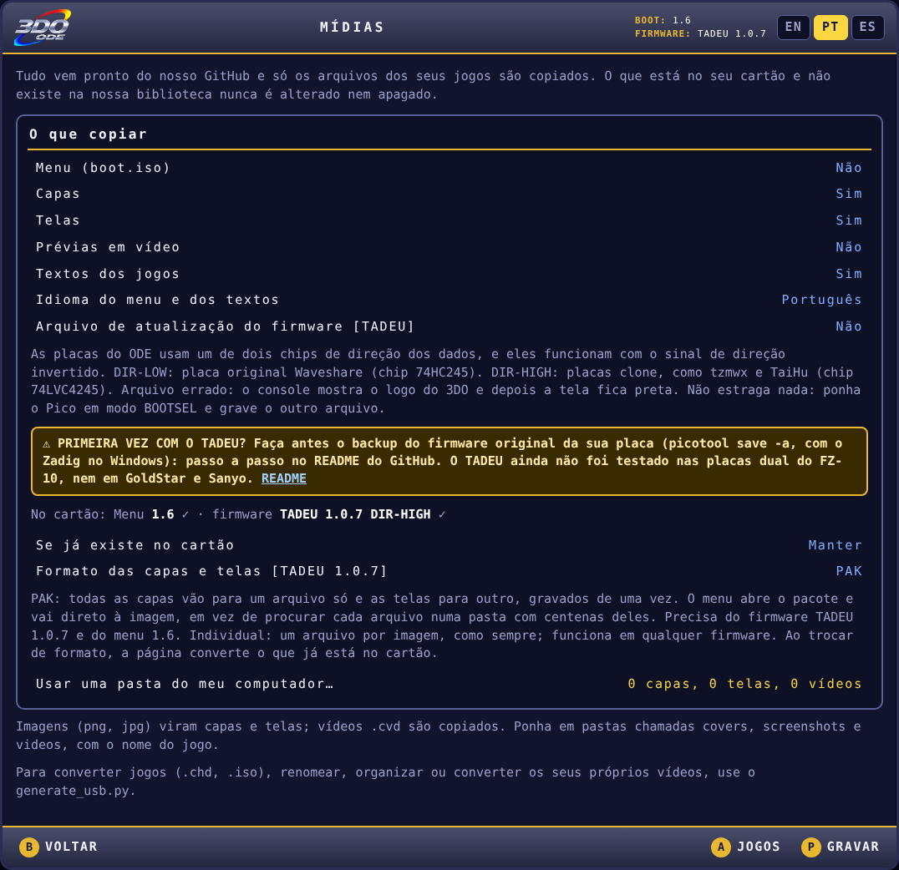
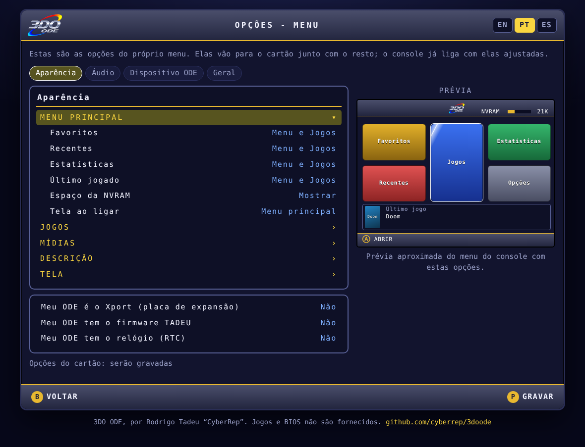
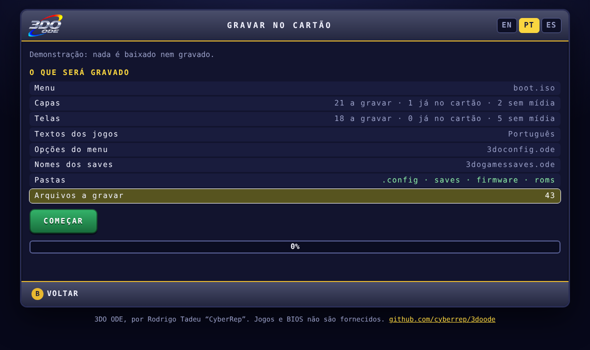
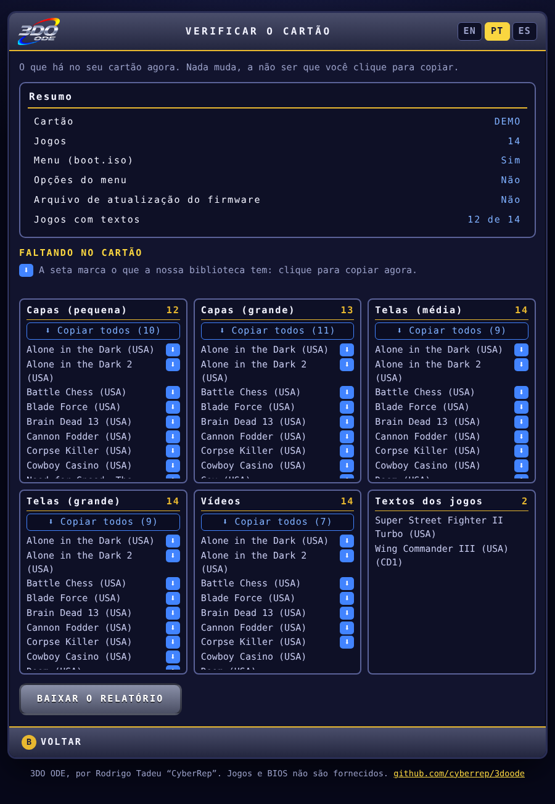

# 🌐 Preparing the USB / SD in the browser — Manual

[← Back to start](../README.md) · **English** · [Português](SITE.pt.md) · [Español](SITE.es.md)

**This is the recommended way.** You open a page, choose your card and it copies the menu, covers, screenshots, videos and texts for your games, ready to use. Nothing to install.

👉 **[https://cyberrep.github.io/3doode/](https://cyberrep.github.io/3doode/)**

> Need to convert games (`.chd`, `.iso`), use Firefox or Safari, or convert your own videos? That is a job for the [Python generator](MANUAL.md).

*(The screenshots below show the page in Portuguese; the buttons are in the same place in English.)*

---

## ✅ What you need

- A **computer** (Windows, Mac or Linux). Phones and tablets will not do.
- **Chrome, Edge, Brave, Opera or Vivaldi**. In Firefox and Safari the page opens, but only shows the demo: those browsers do not allow writing to the card.
- Your **USB / SD**, with the 3DO games already on it (`.iso` or `.cue` + `.bin`).
- Internet. The media comes from our library on GitHub.

**Games and BIOS are not provided.**

---

## 🚀 Step by step

The page has five buttons, in the order you use them: **Card → Games → Media → Options → Write**.

**Easiest way:** click the **Step by step** box in the middle of the screen. It takes you through the five stages in order (Card → Names → Media → Options → Write), with **Back** and **Next** at the bottom. The other boxes are still there to go straight to one stage.

The **How to use** button on the page itself shows a summary of these steps.

### 1. Card — choose the USB / SD

1. Click **Card** and then **Choose the card**.
2. In the browser window, select **the drive of the card** (for example `E:\`) and confirm.
3. The browser asks whether the page may **view and edit the files**. Answer **yes** — without that it cannot write.

The page reads the card and shows how many games it found and what each one is missing.

> Just want to see how it works? Click **Demo**: nothing is downloaded or written.

### 2. Games — check the list

It shows each game and what it has: **cover, screenshot, video and texts**. The legend says where each item comes from:

| Legend | Meaning |
|---|---|
| **on the card** | already written |
| **library** | will be copied from our library |
| **from another region** / **from a similar title** | we do not have the one for that exact disc; we use the one from another version of the same game |
| **yours** | your own file (from your folder) |
| **missing** | we do not have it and neither do you |

Use the filters (**No cover**, **No screenshot**, **No video**, **No texts**) to find what is missing.

**Rename.** Media is matched to the game **by the file name**. If many games show up with nothing, click **Rename → Check the names**: the page proposes the official name of each disc and fixes the `.cue` along with it. Nothing is converted or deleted.
- **by content**: the disc matches the official list, it is certain.
- **by name**: only the title matches — check before ticking.

> The ODE only reads names of up to **126 characters** (with the extension). Above that the media will not open.

### 3. Media — what to copy

Tick what you want on the card:

- **Menu (boot.iso)** — the ODE menu. Leave it on to always have the current version.
- **Covers**, **Screenshots**, **Video previews**, **Game texts**.
- **Language of the menu and texts** — Português, Español or English.
- **If it is already on the card** — **Keep** (only copies what is missing, faster) or **Replace** (writes everything again).
- **Firmware update file** — optional. Only tick it if you are going to update the firmware; see the warning below.
- **Format of covers and screenshots** — **PAK** or **Individual**. Only shows when the card says the ODE has the **TADEU 1.0.7 firmware or newer**.
  - **PAK**: all covers go into a single file and the screenshots into another, written in one go. The menu opens the pack and goes straight to the image; writing the card also gets much faster. Needs menu 1.6.
  - **Individual**: one file per image, as always. Works with any firmware.
  - When you change the format, the page converts what is already on the card.

**The page knows what the card has.** After you power the console on once with menu 1.6, the card stores the menu version and the firmware version. The page shows it under *Media* ("On the card: Menu 1.6 ✓ · firmware TADEU 1.0.7 ✓") and already leaves on **No** whatever is on the current version. The top of the page always shows the current versions: **BOOT** and **FIRMWARE**.

Only the files **for your games** are copied. Whatever is on your card and does not exist in our library is **never changed or deleted**.

**Your own images and videos.** Click **Use a folder from my computer…** and choose a folder with subfolders `covers`, `screenshots` and `videos`. `png`/`jpg` images with the game name become covers and screenshots; `.cvd` videos are copied.

> ⚠️ **First time with TADEU? Back up the original firmware first** (see the warning in the [README](../README.en.md)).
>
> ⚠️ **Firmware: DIR-HIGH or DIR-LOW?**
> **DIR-LOW**: original Waveshare board. **DIR-HIGH**: clone boards (tzmwx, TaiHu).
> Wrote the wrong one? The console shows the 3DO logo and the screen goes black. Nothing is damaged: put the Pico in BOOTSEL and write the other one.

### 4. Options — set up the menu

These are the settings of the console menu itself (appearance, view mode, sound…). They go to the card and the console starts with them already set. The **Preview** shows, roughly, how the menu will look.

Tick what applies to your board: **My ODE is the Xport**, **My ODE has the TADEU firmware**, **My ODE has the clock (RTC)**.

Do not want to touch it? Skip this step: the settings already on the card stay as they are.

### 5. Write

1. Click **Write**. The **"What will be written"** summary shows how many files will go, how many are already on the card and how many games are left without media.
2. Click **Start**.
3. **Leave the tab open until it finishes.** It can take from a few minutes to much longer, depending on the number of games and videos.
4. **"Card ready"** showed up: eject the card safely, put it in the ODE and turn the console on.

At the end, **"What was missing"** lists the games left without some media; you can download the list.

---

## 🔎 Check the card

At any time, **Check the card** shows what is on it now: games, menu, settings, what is **missing** and what is **left over** (media without a game). Nothing changes just by opening that screen. Where the arrow shows up, our library has the file: click to copy it right away, or copy them all at once.

---

## 🔄 Updating to a new menu version

Open the page, choose the card, leave **Menu (boot.iso)** on and **If it is already on the card: Keep**, and write. It replaces the menu and copies only what is missing.

When a version changes the image format (as 1.4 did), the page notices the old covers and screenshots and replaces them by itself on the first write.

---

## ❓ Common problems

| What happens | What to do |
|---|---|
| "This browser cannot write to your card." | Use Chrome, Edge, Brave, Opera or Vivaldi on a computer. |
| The browser will not let you choose the drive | Choose the drive of the card, not a system folder (Desktop, Documents, Downloads). |
| "No games (.iso or .cue) found in this folder." | You chose the wrong folder, or the games are in `.chd`: convert them with the [generator](MANUAL.md). |
| Many games without a cover | The names do not match the official list: use **Rename**. |
| "Could not read the library on GitHub." | No internet, or GitHub is down. Try again in a few minutes. |
| Writing stopped halfway | Click **Write** again with **Keep**: it carries on from where it stopped. |
| The menu shows a short name (like `NISHIM~1`) | File name longer than 126 characters: shorten it. |

---

## 🧰 What the page does not do

- Convert games (`.chd` → `.iso`, `.iso` → `.bin/.cue`).
- Convert your videos to the 3DO format.
- Organise the games into folders.
- Work in Firefox, Safari or on a phone.

For that there is **[generate_usb.py](MANUAL.md)**.
