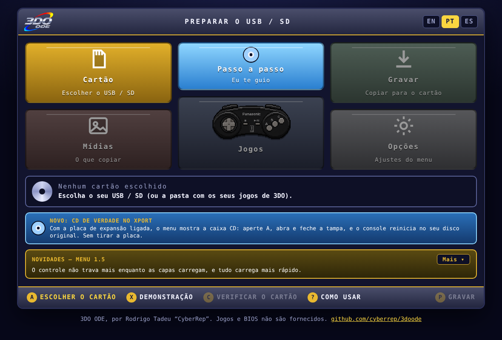
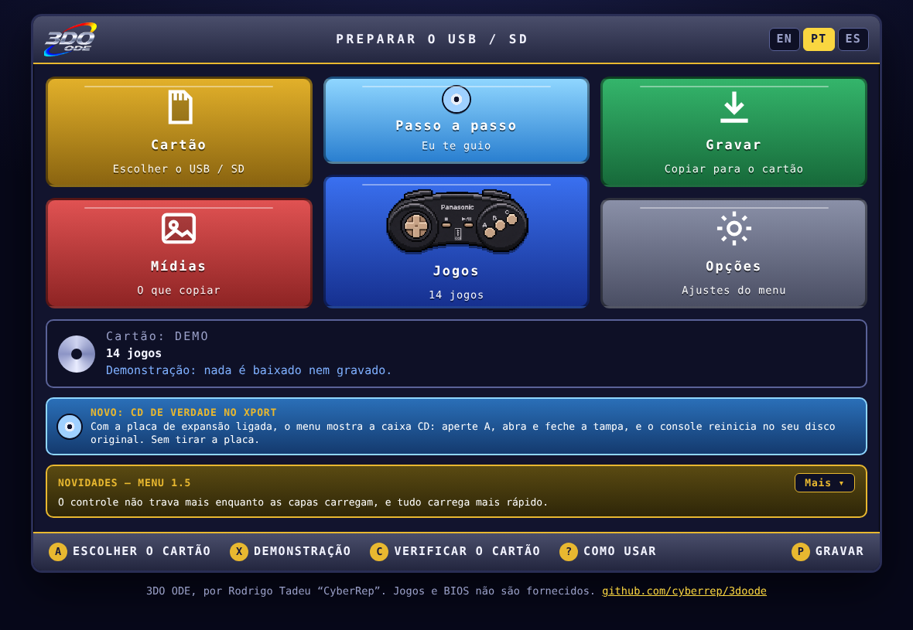
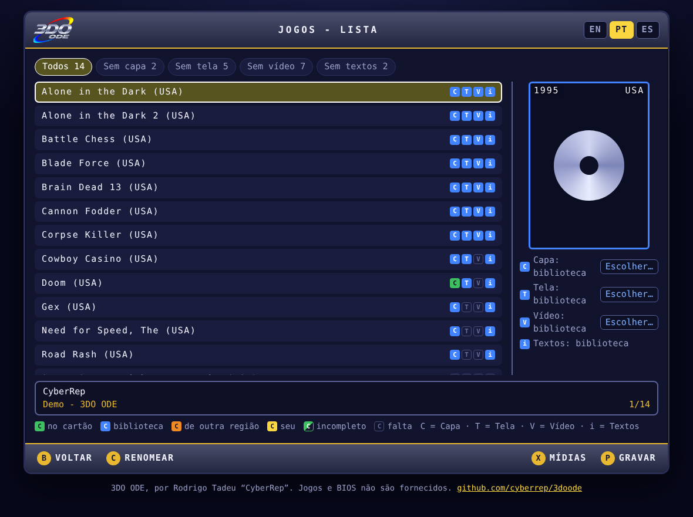
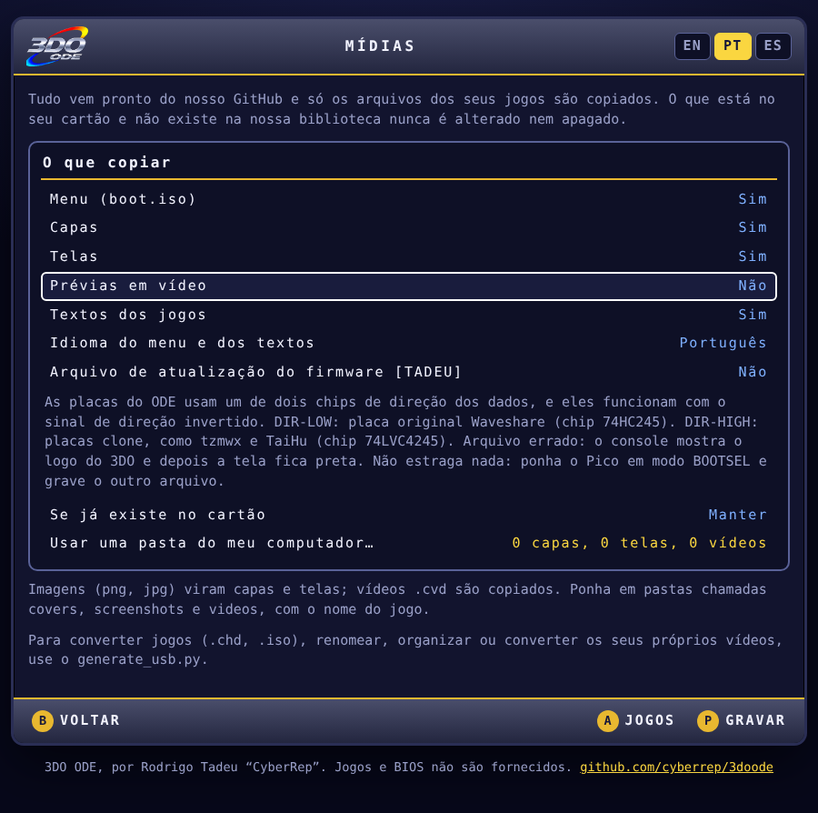
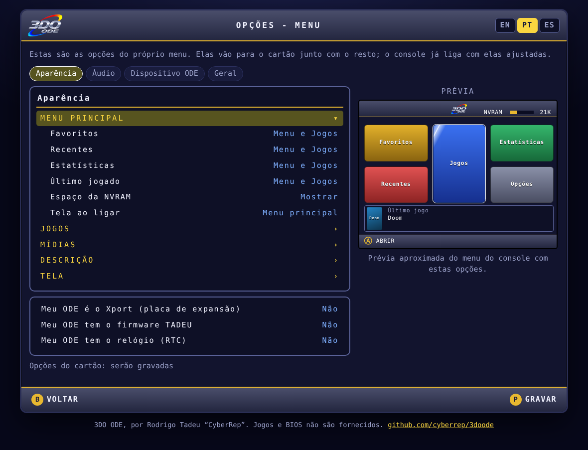
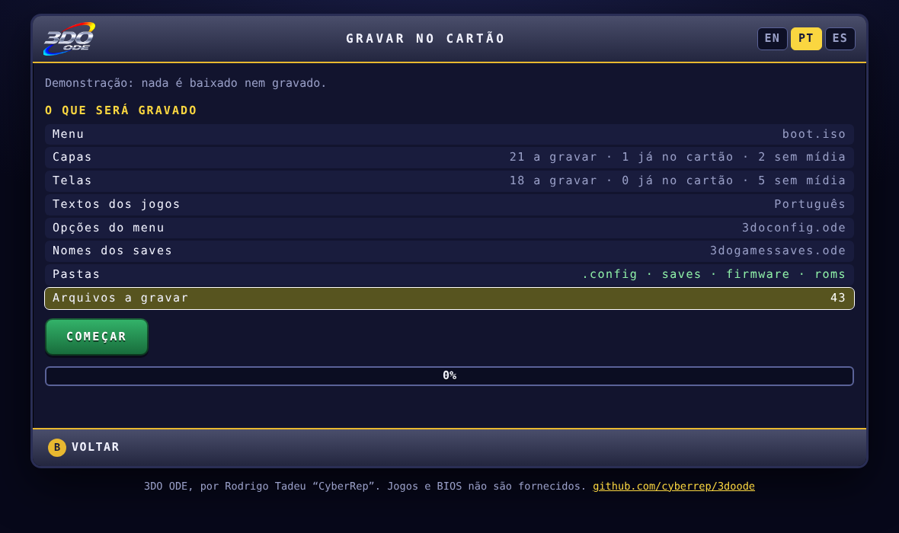
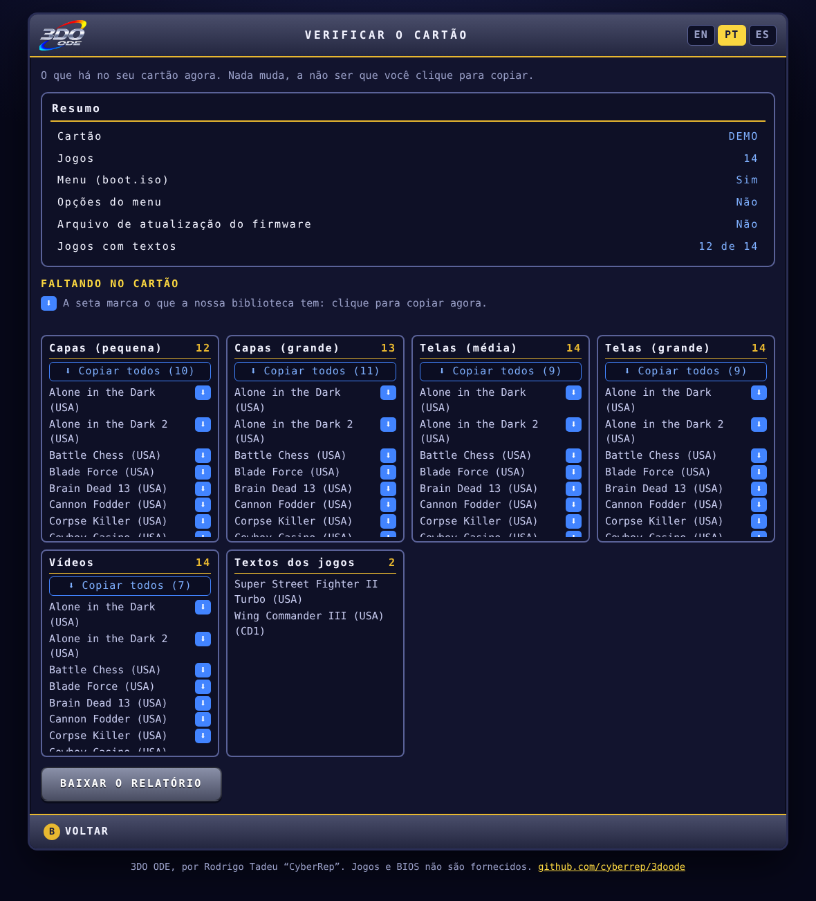

# 🌐 Preparar o USB / SD pelo navegador — Manual

[← Voltar ao início](../README.pt.md) · [English](SITE.md) · **Português** · [Español](SITE.es.md)

**Este é o jeito recomendado.** Você abre uma página, escolhe o seu cartão e ela copia o menu, as capas, as telas, os vídeos e os textos dos seus jogos, já prontos. Não instala nada.

👉 **[https://cyberrep.github.io/3doode/](https://cyberrep.github.io/3doode/)**

> Precisa converter jogos (`.chd`, `.iso`), usar Firefox ou Safari, ou converter os seus próprios vídeos? Aí é com o [gerador em Python](MANUAL.pt.md).

---

## ✅ O que você precisa

- Um **computador** (Windows, Mac ou Linux). Celular e tablet não servem.
- **Chrome, Edge, Brave, Opera ou Vivaldi**. No Firefox e no Safari a página abre, mas só mostra a demonstração: esses navegadores não deixam gravar no cartão.
- O seu **USB / SD**, com os jogos de 3DO já dentro (`.iso` ou `.cue` + `.bin`).
- Internet. As mídias vêm da nossa biblioteca no GitHub.

**Jogos e BIOS não são fornecidos.**

---

## 🚀 Passo a passo

A página tem cinco botões, na ordem em que você usa: **Cartão → Jogos → Mídias → Opções → Gravar**.

**Jeito mais fácil:** clique na caixa **Passo a passo**, no meio da tela. Ela leva você pelas cinco etapas na ordem (Cartão → Nomes → Mídias → Opções → Gravar), com **Voltar** e **Avançar** embaixo. As outras caixas continuam ali para ir direto a uma etapa.

O botão **Como usar** da própria página mostra um resumo destes passos.

### 1. Cartão — escolher o USB / SD

1. Clique em **Cartão** e depois em **Escolher o cartão**.
2. Na janela do navegador, selecione **a unidade do cartão** (por exemplo `E:\`) e confirme.
3. O navegador pergunta se a página pode **ver e editar os arquivos**. Responda **sim** — sem isso ela não consegue gravar.

A página lê o cartão e mostra quantos jogos achou e o que falta em cada um.

> Quer só ver como funciona? Clique em **Demonstração**: nada é baixado nem gravado.

### 2. Jogos — conferir a lista

Mostra cada jogo e o que ele tem: **capa, tela, vídeo e textos**. A legenda diz de onde vem cada item:

| Legenda | Significa |
|---|---|
| **no cartão** | já está gravado |
| **biblioteca** | vai ser copiado da nossa biblioteca |
| **de outra região** / **de título parecido** | não temos a desse disco exato; usamos a de outra versão do mesmo jogo |
| **seu** | arquivo seu (da sua pasta) |
| **falta** | não temos e você não tem |

Use os filtros (**Sem capa**, **Sem tela**, **Sem vídeo**, **Sem textos**) para achar o que falta.

**Renomear.** As mídias são ligadas ao jogo **pelo nome do arquivo**. Se muitos jogos aparecem sem nada, clique em **Renomear → Conferir os nomes**: a página propõe o nome oficial de cada disco e acerta o `.cue` junto. Nada é convertido nem apagado.
- **pelo conteúdo**: o disco bate com a lista oficial, é certeza.
- **pelo nome**: só o título bate — confira antes de marcar.

> O ODE só lê nomes de até **126 letras** (com a extensão). Acima disso as mídias não abrem.

### 3. Mídias — o que copiar

Marque o que você quer no cartão:

- **Menu (boot.iso)** — o menu do ODE. Deixe ligado para ter sempre a versão atual.
- **Capas**, **Telas**, **Prévias em vídeo**, **Textos dos jogos**.
- **Idioma do menu e dos textos** — Português, Español ou English.
- **Se já existe no cartão** — **Manter** (só copia o que falta, mais rápido) ou **Substituir** (grava tudo de novo).
- **Arquivo de atualização do firmware** — opcional. Só marque se for atualizar o firmware; veja o aviso abaixo.

Só os arquivos **dos seus jogos** são copiados. O que está no seu cartão e não existe na nossa biblioteca **nunca é alterado nem apagado**.

**Suas próprias imagens e vídeos.** Clique em **Usar uma pasta do meu computador…** e escolha uma pasta com subpastas `covers`, `screenshots` e `videos`. Imagens `png`/`jpg` com o nome do jogo viram capas e telas; vídeos `.cvd` são copiados.

> ⚠️ **Firmware: DIR-HIGH ou DIR-LOW?**
> **DIR-LOW**: placa original Waveshare. **DIR-HIGH**: placas clone (tzmwx, TaiHu).
> Gravou o errado? O console mostra o logo do 3DO e a tela fica preta. Não estraga nada: ponha o Pico em BOOTSEL e grave o outro.

### 4. Opções — ajustar o menu

São as opções do próprio menu do console (aparência, modo de exibição, som…). Elas vão para o cartão e o console já liga com elas ajustadas. A **Prévia** mostra, de forma aproximada, como o menu vai ficar.

Marque o que vale para a sua placa: **Meu ODE é o Xport**, **Meu ODE tem o firmware TADEU**, **Meu ODE tem o relógio (RTC)**.

Não quer mexer? Pule este passo: as opções que já estão no cartão ficam como estão.

### 5. Gravar

1. Clique em **Gravar**. O resumo **"O que será gravado"** mostra quantos arquivos vão, quantos já estão no cartão e quantos jogos ficam sem mídia.
2. Clique em **Começar**.
3. **Deixe a aba aberta até terminar.** Pode levar de alguns minutos a bem mais, conforme a quantidade de jogos e vídeos.
4. Apareceu **"Cartão pronto"**: ejete o cartão com segurança, ponha no ODE e ligue o console.

No fim, **"O que faltou"** lista os jogos que ficaram sem alguma mídia; dá para baixar a lista.

---

## 🔎 Verificar o cartão

A qualquer momento, **Verificar o cartão** mostra o que há nele agora: jogos, menu, opções, o que **falta** e o que está **sobrando** (mídia sem jogo). Nada muda só por abrir essa tela. Onde aparece a seta, a nossa biblioteca tem o arquivo: clique para copiar na hora, ou use **Copiar todos**.

---

## 🔄 Atualizar para uma versão nova do menu

Abra a página, escolha o cartão, deixe **Menu (boot.iso)** ligado e **Se já existe no cartão: Manter**, e grave. Ela troca o menu e copia só o que estiver faltando.

Quando uma versão muda o formato das imagens (como a 1.4), a página percebe as capas e telas antigas e troca sozinha na primeira gravação.

---

## ❓ Problemas comuns

| O que acontece | O que fazer |
|---|---|
| "Este navegador não consegue gravar no seu cartão." | Use Chrome, Edge, Brave, Opera ou Vivaldi num computador. |
| O navegador não deixa escolher a unidade | Escolha a unidade do cartão, não uma pasta do sistema (Área de Trabalho, Documentos, Downloads). |
| "Nenhum jogo (.iso ou .cue) nesta pasta." | Você escolheu a pasta errada, ou os jogos estão em `.chd`: converta com o [gerador](MANUAL.pt.md). |
| Muitos jogos sem capa | Os nomes não batem com a lista oficial: use **Renomear**. |
| "Não consegui ler a biblioteca no GitHub." | Sem internet, ou o GitHub está fora do ar. Tente de novo em alguns minutos. |
| A gravação parou no meio | Clique em **Gravar** de novo com **Manter**: ela continua de onde parou. |
| O menu mostra nome curto (tipo `NISHIM~1`) | Nome de arquivo com mais de 126 letras: encurte. |

---

## 🧰 O que a página não faz

- Converter jogos (`.chd` → `.iso`, `.iso` → `.bin/.cue`).
- Converter os seus vídeos para o formato do 3DO.
- Organizar os jogos em pastas.
- Funcionar no Firefox, no Safari ou no celular.

Para isso existe o **[generate_usb.py](MANUAL.pt.md)**.
